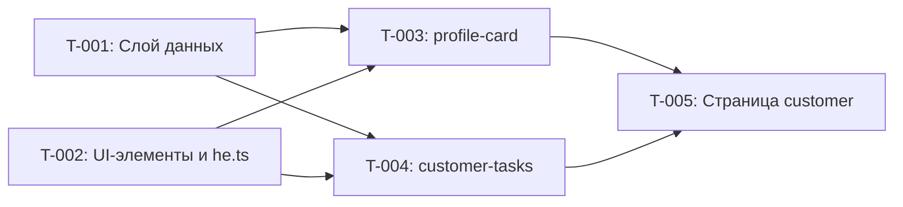

# SPEC-002 — План исполнения

## 1. Meta

| Поле | Значение |
|---|---|
| Эпик | [SPEC-002: Профиль клиента: карточка клиента и задачи по клиенту](./epic.md) |
| Задачи | [tasks.md](./tasks.md) |
| Статус | in-progress |
| Создан | 2026-11-09 |
| Исполнитель | агент `react-engineer` |
| Режим остановки | per-wave — пауза после каждой волны |
| Параллельность | не больше 3 агентов в волне |
| Ревью | независимое, `/reviewer:review`; не больше 2 раундов |

Статус: `not-started` → `in-progress` → `completed` / `blocked`. Пишет оркестратор.

## 2. Сводка

- **Задач:** 5
- **Волн:** 3
- **Критический путь:** 3 задачи

Фундамент — две независимые задачи: слой данных (T-001) и общие UI-элементы со словарём
строк (T-002). Работа расходится параллельно на два виджета (T-003, T-004), которые
друг от друга не зависят, и сходится в одной задаче сборки страницы (T-005).
`src/shared/i18n/he.ts` правит только T-002.

## 3. Граф зависимостей

Стрелка: источник блокирует цель.

## 4. Критический путь

`T-001 → T-003 → T-005` (равнозначно через T-004; T-001 и T-002 — оба размера M).

Параллельность эту цепочку не сокращает — за блокерами на ней следим в первую очередь.
Самый рискованный узел — T-001 (верхняя граница M, три модуля).

## 5. Dry-run: конфликты до старта

### Пересечения путей внутри волны

| Волна | Задачи | Общий путь | Риск | Решение |
|---|---|---|---|---|
| 1 | T-001, T-002 | нет (`shared/api`, `entities/*` против `shared/ui/*`, `he.ts`) | — | — |
| 2 | T-003, T-004 | нет (`widgets/profile-card` против `widgets/customer-tasks`) | — | `he.ts` и `shared/ui` в волне 2 только читаются |
| 3 | T-005 | — (одна задача) | — | — |

Общие файлы вне путей задач: `src/shared/ui/index.ts` — только T-002; `package.json`,
lock-файл — никто. `npm run validate` во время параллельной волны может показать ошибку
типов или линта в чужом, ещё не дописанном файле — исполнители о ней сообщают, не чинят.

### Внешние зависимости

- **Пакеты:** новых нет.
- **Переменные окружения:** `VITE_API_BASE_URL` — уже есть, читается только в `shared/config/env.ts`.
- **Внешние сервисы:** DummyJSON; без сети — `npm run dev:offline`. Тесты сеть не трогают.

## 6. Волны

### Волна 1 — Фундамент

- **Задачи:** T-001, T-002
- **Параллельно:** 2 агента
- **Проверка в конце:** `npm run validate`
- **Что должно получиться:** хуки `useCustomer` и `useCustomerTasks` с тестами; `Card`,
  `StatusBadge`, `Avatar`, `Loader` в `@/shared/ui`; все строки эпика §6 в `he.ts`.

### Волна 2 — Виджеты

- **Задачи:** T-003, T-004
- **Параллельно:** 2 агента
- **Ждёт:** волну 1
- **Проверка в конце:** `npm run validate`
- **Что должно получиться:** `ProfileCard` и `CustomerTasks` со всеми состояниями, покрытые
  тестами; на странице они ещё не подключены.

### Волна 3 — Сборка страницы

- **Задачи:** T-005
- **Ждёт:** волну 2
- **Проверка в конце:** `npm run validate`, `grep` из AC-14 эпика, `git status` по `package.json`,
  lock-файлу, `tools/`, `docs/design/`
- **Что должно получиться:** `/customers/N` показывает две карточки; недопустимый id даёт
  «הלקוח לא נמצא» без запроса; тесты оболочки SPEC-001 проходят с подменой `fetch`.

## 7. Гейты

Перед записью каждой строки проверено, что инструмент существует.

| Гейт | Когда | Чем | Подключён |
|---|---|---|---|
| G4 Task DoD | после каждой задачи | `npm run validate` + hand-off | да (`.claude/agents/react-engineer.md` есть) |
| G5 Review | после последней волны | `/reviewer:review` → `/sdd fix`, до 2 раундов | aspirational — not wired (`claude plugin list` не содержит `reviewer`) |
| G6 Security | после `APPROVED` | `/security-review`, `npm run audit:deps` | да (`git rev-parse --verify origin/HEAD` проходит) |
| G7 Spec close | после security | `/sdd close` | да |
| G8 Build | в `/sdd close` | `npm run release:check` | да |
| G9 Release | в конце | `npm run preview` + ручная проверка | да |

## 8. Риски исполнения

| Риск | Вероятность | Что делаем |
|---|---|---|
| T-001 не вмещается в M | средняя | исполнитель останавливается и сообщает; оркестратор режет задачу, не исполнитель |
| Внешний API недоступен из сети | средняя | `npm run dev:offline`; тесты сеть не трогают |
| Общий хук `useAsyncResource` — расширение эпика §8 | низкая | зафиксировать решение владельца до запуска волны 1 |
| Размер аватара без токена (эпик §13 п. 10) | низкая | временно `--space-16`; решение владельца |
| `App.test.tsx` ходит в сеть после сборки страницы | высокая | покрыто в T-005 (подмена `fetch`, прежние проверки не менять) |

## 9. Журнал прогресса

Пишет только оркестратор — исполнители возвращают свою строку в hand-off.

| Задача | Волна | Начата | Завершена | Статус | Гейт | Заметки |
|---|---|---|---|---|---|---|
| T-001 | 1 | 2026-11-09 | 2026-11-09 | completed | validate зелёный (106 тестов) | 2 попытки: Bash отклонён в сессии агента; 1 возврат — NaN в `useAsyncResource` (`Object.is`) |
| T-002 | 1 | 2026-11-09 | 2026-11-09 | completed | validate зелёный (106 тестов) | браузер недоступен — сверка с PNG за человеком; `Loader` с `aria-label`; размер аватара `--space-16` (эпик §13 п.10) |
| T-003 | 2 | 2026-11-09 | 2026-11-09 | completed | validate зелёный (134 теста) | 2 попытки: Bash отклонён в первой, файлов не создано; браузер недоступен, сверка с PNG после T-005 |
| T-004 | 2 | 2026-11-09 | 2026-11-09 | completed | validate зелёный (134 теста) | браузер недоступен, сверка с PNG после T-005 |
| T-005 | 3 | | | not-started | | |
