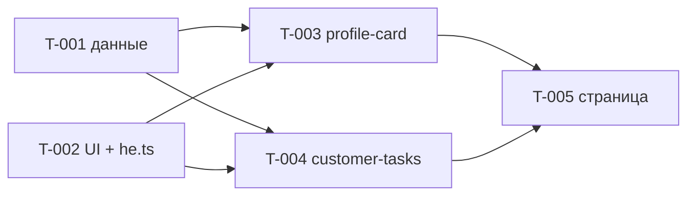

# SPEC-002 — Задачи

**Эпик:** [SPEC-002: Профиль клиента: карточка клиента и задачи по клиенту](./epic.md)
**Статус:** in-progress
**Создан:** 2026-11-09

## Индекс задач

| ID | Название | Тип | Размер | Статус | Blocked by | Blocks |
|---|---|---|---|---|---|---|
| T-001 | Слой данных: HTTP-клиент, хук загрузки, сущности `customer` и `customer-task` | feature | M | completed | — | T-003, T-004 |
| T-002 | Общие UI-элементы и словарь строк | feature | M | completed | — | T-003, T-004 |
| T-003 | Виджет `profile-card` | feature | M | not-started | T-001, T-002 | T-005 |
| T-004 | Виджет `customer-tasks` | feature | M | not-started | T-001, T-002 | T-005 |
| T-005 | Страница `customer`: разбор id и сборка | feature | S | not-started | T-003, T-004 | — |

Размер: `S` — один компонент или модуль; `M` — несколько файлов, небольшие проектные
решения. T-001 — верхняя граница `M` (три модуля в трёх слайсах); если исполнитель
упирается в объём, он останавливается и сообщает, а не режет углы.

Статус: `not-started` → `in-progress` → `completed` / `blocked`.

## Граф зависимостей



Волны: **1** — T-001 ∥ T-002; **2** — T-003 ∥ T-004; **3** — T-005.
`src/shared/i18n/he.ts` правит только T-002.

## Трассировка AC эпика

Каждый AC эпика достался хотя бы одной задаче. Первой указана задача, чей тест
главный; остальные проверяют свою часть.

| AC эпика | Задачи |
|---|---|
| AC-1 | T-005 (разбор id), T-001 (защита id в запросе) |
| AC-2 | T-003 |
| AC-3 | T-003, T-004, T-002 (индикатор) |
| AC-4 | T-003, T-004, T-001 (`404` → `not-found`) |
| AC-5 | T-003, T-004, T-001 (`retry`) |
| AC-6 | T-001 (маппер), T-003, T-004 |
| AC-7 | T-004, T-002 (`StatusBadge`) |
| AC-8 | T-004 |
| AC-9 | T-005, T-003, T-004 |
| AC-10 | T-001 (`avatarUrl`), T-002 (откат при `error`), T-003 |
| AC-11 | T-001 (ключи модели, логи), T-003, T-004 (DOM) |
| AC-12 | T-001 (хук), T-005 (страница) |
| AC-13 | T-001 (хук), T-005 (страница) |
| AC-14 | T-002, T-003, T-004, T-005 (итоговый `grep`) |
| AC-15 | T-002, T-003, T-004 |
| AC-16 | T-005 (итоговая проверка), все задачи (не трогать `package.json`) |

---

## T-001: Слой данных — HTTP-клиент, хук загрузки, сущности

### Meta

| Поле | Значение |
|---|---|
| Тип | feature |
| Размер | M |
| Статус | completed |
| Scope paths | `src/shared/api/**`, `src/entities/customer/**`, `src/entities/customer-task/**` |
| Blocked by | — |
| Blocks | T-003, T-004 |
| Разделы эпика | §5 FR-1 (защита id), FR-2, FR-3, FR-4, FR-7, FR-8; §7; §9 Безопасность, Надёжность; §10 AC-4, AC-5, AC-6, AC-10, AC-11, AC-12, AC-13 |

### Цель

`useCustomer(id)` и `useCustomerTasks(id)` отдают размеченное объединение `LoadState`,
собирают модель белым списком, отменяют запросы и не показывают данные прежнего клиента.

### Контекст

Фундамент данных. Виджеты T-003 и T-004 берут из него только хуки и типы моделей.
Строк интерфейса здесь нет, поэтому `he.ts` не трогается.

### Входит

- `shared/api`: HTTP-клиент, типизированные ошибки, проверка id, типы `LoadState` /
  `ILoadResult`, общий хук загрузки `useAsyncResource` (отмена, гонка, `retry`) —
  чтобы логика `AbortController` жила в одном месте, а не копировалась в две сущности.
- `entities/customer`: запрос, тип `Customer`, маппер, `useCustomer`.
- `entities/customer-task`: запрос, тип `CustomerTask`, маппер, `useCustomerTasks`.
- Юнит-тесты мапперов, клиента, хуков.

### Не входит

- Компоненты, CSS, строки, `he.ts` (T-002 и виджеты).
- Вычисление инициалов (T-003).
- Разбор `:customerId` из адреса (T-005): здесь только защита самого запроса.
- Новые пакеты, правки `env.ts`.

### Контракты

```ts
// shared/api/index.ts — публичный API слайса
export class HttpError extends Error { readonly status: number }   // ответ не-2xx
export class NetworkError extends Error {}                          // сетевой сбой
export class ParseError extends Error {}                            // невалидный JSON
export function getJson(path: string, options?: { signal?: AbortSignal }): Promise<unknown>
// URL = env.apiBaseUrl + path (env из '@/shared/config/env'). Отмена: промис
// отклоняется как AbortError, не оборачивается в NetworkError.
export function isAbortError(error: unknown): boolean

export function parseResourceId(raw: string | undefined): number | null
// ^[1-9][0-9]*$ и Number.isSafeInteger → число, иначе null.
// Допустимо: '1', '42'. Недопустимо: 'abc','0','-1','1.5','007','1e3','', undefined.
export function isResourceId(value: number): boolean   // целое > 0, safe integer

export type LoadState<T> =
  | { status: 'loading' }
  | { status: 'success'; data: T }
  | { status: 'not-found' }
  | { status: 'error' }
export interface ILoadResult<T> { state: LoadState<T>; retry: () => void }

export function useAsyncResource<T>(
  key: number,
  load: (signal: AbortSignal) => Promise<T>,
): ILoadResult<T>
// - первый рендер и любая смена key: state = loading уже в том же рендере
//   (данные прежнего key не показываются ни на один кадр);
// - HttpError 404 → not-found; любая другая ошибка (HttpError, NetworkError,
//   ParseError, ошибка маппера) → error; AbortError игнорируется;
// - при смене key и размонтировании запрос отменяется; поздний ответ не
//   записывается; retry() отменяет текущий запрос и запускает новый.

// entities/customer/index.ts
export interface Customer {
  id: number; firstName: string; lastName: string
  phone: string; email: string; city: string
  avatarUrl: string | null            // только https://, иначе null
}
export function useCustomer(customerId: number): ILoadResult<Customer>
// GET /users/{id}. Маппер принимает unknown, в index.ts не экспортируется.

// entities/customer-task/index.ts
export interface CustomerTask { id: number; text: string; isCompleted: boolean }
export function useCustomerTasks(customerId: number): ILoadResult<CustomerTask[]>
// GET /users/{id}/todos → { todos: [...] }. Маппер принимает unknown.
```

Таблица маппинга (из эпика §7):

| Поле модели | Источник | Правило |
|---|---|---|
| `Customer.id` | `id` | обязательное, целое > 0 |
| `firstName`, `lastName`, `phone`, `email` | одноимённые | обязательные, непустая строка |
| `city` | `address.city` | обязательное, непустая строка; `address` — объект |
| `avatarUrl` | `image` | необязательное; строка с `https://` → она же, иначе `null` |
| `CustomerTask.id` | `todos[].id` | обязательное, целое |
| `text` | `todos[].todo` | обязательное, строка |
| `isCompleted` | `todos[].completed` | обязательное, boolean |

Любое нарушение, `todos` не массив, корень не объект — ошибка. Модель собирается по
одному полю, спред сырого ответа запрещён. Функции запроса сущностей бросают
`RangeError`, если `isResourceId(customerId)` ложно — запрос не уходит.
Не выходят за слой: `password`, `ssn`, `bank`, `ip`, `macAddress`, `crypto`, `userId`
задач и любые поля сверх таблицы. В `console.*` ответы и ПДн не пишутся.

### Файлы

| Путь | Действие | Назначение |
|---|---|---|
| `src/shared/api/httpClient.ts`, `errors.ts`, `resourceId.ts`, `useAsyncResource.ts`, `types.ts`, `index.ts` | создать (убрать `.gitkeep`) | клиент, ошибки, id, хук, типы |
| `src/shared/api/__tests__/*.test.ts(x)` | создать | клиент, `parseResourceId`, хук |
| `src/entities/customer/{api,model}/…`, `index.ts` | создать | запрос, `Customer`, маппер, `useCustomer` |
| `src/entities/customer/__tests__/*` | создать | маппер, хук |
| `src/entities/customer-task/{api,model}/…`, `index.ts` | создать | то же для задач |
| `src/entities/customer-task/__tests__/*` | создать | маппер, хук |

### Критерии приёмки

- **AC-1** — `getJson` на не-2xx бросает `HttpError` со статусом, на сетевой сбой —
  `NetworkError`, на невалидный JSON — `ParseError`; отмена — `AbortError`. *(эпик AC-4, AC-5, AC-12)*
- **AC-2** — `parseResourceId` принимает `'1'`, `'42'` и возвращает `null` для всех
  недопустимых значений из контракта; запрос сущности с недопустимым id не вызывает `fetch`. *(эпик AC-1)*
- **AC-3** — Мапперы отдают модель ровно с ключами `id, firstName, lastName, phone, email,
  city, avatarUrl` и `id, text, isCompleted`; значения чувствительных полей фикстуры нигде
  не встречаются в модели; ни один `console.*` не вызван со значениями этих полей. *(эпик AC-11)*
- **AC-4** — Каждое нарушение правил маппинга (нет `firstName`; `address` отсутствует;
  `phone` — число; корень — массив; `todos` не массив; нет `todo`; `completed` не boolean)
  даёт `error`. *(эпик AC-6)*
- **AC-5** — `image`: `https://…` → URL; `http://…`, `javascript:…`, `data:…`, `''`,
  отсутствует → `null`. *(эпик AC-10)*
- **AC-6** — Хуки: `404` → `not-found`, `500`/сеть → `error`; `retry()` повторяет запрос по
  тому же адресу и приводит к `success`. *(эпик AC-4, AC-5)*
- **AC-7** — Гонка: ответ по прежнему id, пришедший после ответа по новому, не меняет
  состояние; запрос прежнего id отменён через `AbortSignal`; при смене id `state` — `loading`
  в том же рендере; размонтирование отменяет запрос, ошибок в консоли нет. *(эпик AC-12, AC-13)*

### Тесты

**Основные сценарии:**

- **S-1** — Given фикстура профиля со всеми чувствительными полями, when `mapCustomer`,
  then ключи модели ровно из белого списка, значения `password/ssn/bank/…` не найдены
  в `JSON.stringify(модель)`; `console.*` не вызывался — покрывает AC-3.
- **S-2** — Given набор неверных тел (таблица `it.each`), when маппер, then ошибка;
  парный позитивный случай — валидное тело → модель — покрывает AC-4.
- **S-3** — Given `fetch` отвечает `404`, затем `500`, затем сетевой сбой, when хук,
  then `not-found`, `error`, `error`; после `retry()` с успешным ответом — `success`,
  `fetch` вызван повторно с тем же адресом — покрывает AC-6.
- **S-4** — Given два управляемых промиса, when id сменился 1→2, ответ 2 пришёл раньше
  ответа 1, then состояние — данные 2; сигнал запроса 1 `aborted`; сразу после смены id
  `state.status === 'loading'` — покрывает AC-7.
- **S-5** — Given `parseResourceId` с таблицей допустимых и недопустимых значений и
  `getJson` с тремя видами сбоев — покрывает AC-1, AC-2, AC-5.

**Дополнительные сценарии** (заполняет исполнитель по ходу):

- (пусто)

**Ручная проверка:**

- [ ] нет — полностью автоматизировано

### Ссылки

- Эпик: §5, §7, §8, §9, §10
- Конвенции: § 1 (слои, `public-api`), § 6 (данные, отмена), § 7 (безопасность),
  § 8 (тесты: `vi.stubGlobal('fetch', …)`, фикстура с чувствительными полями)

---

## T-002: Общие UI-элементы и словарь строк

### Meta

| Поле | Значение |
|---|---|
| Тип | feature |
| Размер | M |
| Статус | completed |
| Scope paths | `src/shared/ui/Card/**`, `src/shared/ui/StatusBadge/**`, `src/shared/ui/Avatar/**`, `src/shared/ui/Loader/**`, `src/shared/ui/index.ts`, `src/shared/i18n/he.ts` |
| Blocked by | — |
| Blocks | T-003, T-004 |
| Разделы эпика | §5 FR-6 (откат аватара); §6; §8 (shared); §9 Доступность, Стили и строки; §10 AC-3, AC-7, AC-10, AC-14, AC-15 |

### Цель

Виджеты берут из `@/shared/ui` готовые `Card`, `StatusBadge`, `Avatar`, `Loader`, а из
`he` — все строки §6 эпика; `he.ts` после этой задачи больше никто не правит.

### Контекст

Общий фундамент интерфейса. Единственная задача, которая пишет `he.ts`, поэтому
добавляет сразу всё, что понадобится виджетам и странице. Компоненты универсальны —
слов предметной области («customer», «task») в `shared` нет.

### Входит

- Четыре компонента с `I<Name>.ts`, `.module.css`, тестами; реэкспорт в `shared/ui/index.ts`.
- Новые ключи `he.ts` (существующие ключи не менять и не переименовывать).

### Не входит

- Состояния «пусто / не найдено / ошибка» с кнопкой — их рисуют виджеты своей разметкой
  (общего компонента в эпике нет; см. «Открытые вопросы» в отчёте оркестратора).
- Вычисление инициалов (T-003), проверка `https://` (T-001: маппер).
- Правки `tokens.css`, `global.css`.

### Контракты

```ts
// Card — секция с заголовком h2
interface ICardProps { title: string; children: ReactNode }

// StatusBadge — текстовая метка; смысл передаётся текстом, тон — цветом
interface IStatusBadgeProps { tone: 'success' | 'warning'; children: ReactNode }
//   success → --success*, warning → --warning*

// Avatar — картинка с откатом на инициалы
interface IAvatarProps { src: string | null; initials: string }
//   src === null → только инициалы;  при src;
//   событие error у img → инициалы. Размер — токен --space-16 (подходящего
//   токена размера аватара нет; решение владельца — эпик §13 п. 10).

// Loader — индикатор загрузки
interface ILoaderProps { label: string }
//   role="status", aria-busy="true", виден текст label; внешний вид — как .skeleton референса

// he.ts — новые ключи (имена фиксированы, их цитируют T-003, T-004, T-005)
//   states:        { notFound: 'הלקוח לא נמצא',
//                    error: 'לא הצלחנו לטעון את הנתונים', retry: 'נסו שוב' }
//   profileCard:   { title: 'פרטי לקוח', loading: 'טוען פרטי לקוח',
//                    fields: { id: 'מס׳ לקוח', phone: 'טלפון',
//                              email: 'דוא״ל', city: 'עיר' } }
//   customerTasks: { title: 'משימות טיפול', loading: 'טוען משימות',
//                    empty: 'אין משימות ללקוח',
//                    status: { open: 'פתוח', done: 'בוצע' } }
```

### Файлы

| Путь | Действие | Назначение |
|---|---|---|
| `src/shared/ui/Card/{Card.tsx,ICard.ts,Card.module.css,__tests__/Card.test.tsx}` | создать | карточка |
| `src/shared/ui/StatusBadge/…` | создать | статус |
| `src/shared/ui/Avatar/…` | создать | аватар |
| `src/shared/ui/Loader/…` | создать | загрузка |
| `src/shared/ui/index.ts` | создать | реэкспорт четырёх компонентов и их `I*Props` |
| `src/shared/i18n/he.ts` | изменить | только добавить ключи выше |

### Критерии приёмки

- **AC-1** — `Card` рисует заголовок как `heading` уровня 2 с переданным `title` и
  содержимое. *(эпик AC-15)*
- **AC-2** — `Loader` находится по роли `status` и имени `label`, имеет `aria-busy="true"`. *(эпик AC-3)*
- **AC-3** — `Avatar` с `src` рисует `img` с пустым `alt`; без `src` и после события
  `error` рисует инициалы и не рисует `img`. *(эпик AC-10)*
- **AC-4** — `StatusBadge` показывает переданный текст в обоих тонах; тон не единственный
  носитель смысла. *(эпик AC-7)*
- **AC-5** — В новых `*.module.css` нет цветовых литералов и числовых `px`/`rem`; в новых
  `*.tsx`/`*.ts` нет ивритских литералов (кроме `he.ts`). *(эпик AC-14)*

### Тесты

**Основные сценарии:**

- **S-1** — Given `<Card title={he.profileCard.title}>`, then `heading` уровня 2 с этим
  именем; содержимое видно — AC-1.
- **S-2** — Given `<Loader label={he.profileCard.loading}/>`, then `status` с именем и
  `aria-busy="true"` — AC-2.
- **S-3** — Given `src="https://…"`, then `img` есть; when `fireEvent.error(img)`, then
  `img` нет, инициалы видны — AC-3.
- **S-4** — Given `src={null}`, then `img` нет, инициалы видны (негативная пара к S-3) — AC-3.
- **S-5** — Given `StatusBadge` с `tone="warning"` и `tone="success"`, then текст виден в
  обоих — AC-4. AC-5 проверяется `grep` из эпика AC-14 в hand-off.

**Дополнительные сценарии** (заполняет исполнитель по ходу):

- (пусто)

**Ручная проверка:**

- [ ] нет — полностью автоматизировано (внешний вид сверяется в T-003 и T-004)

### Ссылки

- Эпик: §6 (таблица строк), §8, §9, §13 п. 10
- Дизайн: `.card`, `.status*`, `.skeleton`, `.profile*` в `customer-360.reference.html` — только `grep`
- Конвенции: § 2 (папка компонента, `I<Name>.ts`), § 3 (токены, RTL), § 4 (строки), § 5 (a11y)

---

## T-003: Виджет `profile-card`

### Meta

| Поле | Значение |
|---|---|
| Тип | feature |
| Размер | M |
| Статус | not-started |
| Scope paths | `src/widgets/profile-card/**` |
| Blocked by | T-001, T-002 |
| Blocks | T-005 |
| Разделы эпика | §5 FR-2, FR-4, FR-5, FR-6; §6; §9; §10 AC-2, AC-3, AC-4, AC-5, AC-6, AC-10, AC-11, AC-14, AC-15 |

### Цель

`<ProfileCard customerId={n} />` показывает карточку клиента во всех состояниях: данные,
загрузка, не найден, ошибка с повтором.

### Контекст

Использует `useCustomer` (T-001) и компоненты `shared/ui` с ключами `he` (T-002).
Независим от виджета задач: сбой одной карточки не затрагивает другую.

### Входит

- Компонент `ProfileCard`, `IProfileCardProps`, CSS-модуль, `index.ts`, тесты.
- Хук виджета для подготовки отображения (инициалы, полное имя) — вычисления не в теле рендера.

### Не входит

- Запросы, маппер, `LoadState` (T-001); `Card`, `Avatar`, `Loader`, `he.ts` (T-002; не править).
- Карточка задач (T-004), разбор id (T-005).
- Блоки скриншота вне брифа: год присоединения, «מבוטחת פעילה», WhatsApp.

### Контракты

Цитируются из T-001 и T-002; в этих слайсах ничего не менять.

```ts
// @/entities/customer (T-001)
interface Customer { id: number; firstName: string; lastName: string
  phone: string; email: string; city: string; avatarUrl: string | null }
function useCustomer(customerId: number): ILoadResult<Customer>
// @/shared/api (T-001) — типы
type LoadState<T> = { status: 'loading' } | { status: 'success'; data: T }
  | { status: 'not-found' } | { status: 'error' }
interface ILoadResult<T> { state: LoadState<T>; retry: () => void }

// @/shared/ui (T-002)
Card({ title }), Loader({ label }), Avatar({ src, initials }), StatusBadge(...)

// @/shared/i18n/he (T-002)
he.profileCard.title / .loading / .fields.{id,phone,email,city}
he.states.notFound / .error / .retry

// эта задача
interface IProfileCardProps { customerId: number }
// widgets/profile-card/index.ts: export { ProfileCard }
```

Состояния: `loading` → `Loader` с `he.profileCard.loading`, подписей и значений нет;
`not-found` → `he.states.notFound`, без кнопки повтора и без подписей;
`error` → `he.states.error` в `role="alert"` + `button` `he.states.retry` → `retry()`;
`success` → аватар, «имя фамилия», четыре пары «подпись: значение». Инициалы — первая
буква имени + первая буква фамилии. Телефон и почта — `dir="ltr"`, `text-align: start`;
длинные значения переносятся. Заголовок карточки — `Card` с `he.profileCard.title`.

### Файлы

| Путь | Действие | Назначение |
|---|---|---|
| `src/widgets/profile-card/ProfileCard.tsx` | создать | компонент |
| `src/widgets/profile-card/IProfileCard.ts` | создать | `IProfileCardProps` |
| `src/widgets/profile-card/ProfileCard.module.css` | создать | стили, только токены, логические свойства |
| `src/widgets/profile-card/useProfileCardView.ts` (имя на усмотрение) | создать | инициалы, полное имя |
| `src/widgets/profile-card/index.ts` | создать | публичный API |
| `src/widgets/profile-card/__tests__/ProfileCard.test.tsx` | создать | тесты |

### Критерии приёмки

- **AC-1** — Given корректный профиль, then видны полное имя и четыре значения с подписями
  (номер = `id`, город = `address.city`). *(эпик AC-2)*
- **AC-2** — Given ответ не пришёл, then `status` «טוען פרטי לקוח» с `aria-busy`, подписей нет;
  после ответа индикатор исчезает. *(эпик AC-3)*
- **AC-3** — Given `404`, then «הלקוח לא נמצא», нет кнопки «נסו שוב», нет подписей. *(эпик AC-4)*
- **AC-4** — Given `500` или сеть, then `alert` с ошибкой и кнопка; после нажатия и успешного
  повтора — данные, `fetch` вызван повторно с тем же адресом. Given тело неожиданной формы —
  то же поведение, виджет не падает. *(эпик AC-5, AC-6)*
- **AC-5** — Given `image` `https://…` — есть изображение; `http://…`, `javascript:…`, `data:…`,
  `''`, нет поля, либо событие `error` — инициалы. *(эпик AC-10)*
- **AC-6** — Значения `password`, `ssn`, `bank`, `ip`, `macAddress`, `crypto` из фикстуры не
  присутствуют в DOM. *(эпик AC-11)*
- **AC-7** — Заголовок «פרטי לקוח» находится по роли `heading`; кнопка — по роли `button` и имени. *(эпик AC-15)*
- **AC-8** — В файлах виджета нет ивритских литералов, цветовых литералов и числовых `px`/`rem`. *(эпик AC-14)*

### Тесты

**Основные сценарии** (`fetch` через `vi.stubGlobal`, фикстура с чувствительными полями):

- **S-1** — Given успешный ответ, then имя, `id`, телефон, почта, город с подписями; чувствительные
  значения отсутствуют в `document.body` — AC-1, AC-6.
- **S-2** — Given неразрешённый промис, then `status` с именем и `aria-busy`, нет подписей; после
  разрешения индикатор исчез — AC-2.
- **S-3** — Given `404`, then «הלקוח לא נמצא», `queryByRole('button', { name: retry })` пуст — AC-3.
- **S-4** — Given `500`, затем успех: `alert` + кнопка; клик (`userEvent`) → данные, `fetch`
  вызван дважды с одним адресом. Парно: тело без `firstName` → то же сообщение — AC-4.
- **S-5** — Given `image` из таблицы значений: `https://` → есть `img`; остальные и `error` → инициалы
  (`it.each`) — AC-5.

**Дополнительные сценарии** (заполняет исполнитель по ходу):

- (пусто)

**Ручная проверка:**

- [ ] Открыть виджет в браузере (временный монтаж запрещён вне scope — проверяется после T-005)
  и сверить со скриншотом. Если браузера нет — записать это в hand-off.

### Ссылки

- Эпик: §5, §6, §9, §10
- Дизайн: `docs/design/customer-360.png` (блок «פרטי לקוחה»); классы `.profile*`, `.card`,
  `.skeleton`, `.empty-state`, `.error-state` — только `grep`
- Конвенции: § 2, § 3 (RTL, токены), § 4, § 5, § 6 (`LoadState`), § 8

---

## T-004: Виджет `customer-tasks`

### Meta

| Поле | Значение |
|---|---|
| Тип | feature |
| Размер | M |
| Статус | not-started |
| Scope paths | `src/widgets/customer-tasks/**` |
| Blocked by | T-001, T-002 |
| Blocks | T-005 |
| Разделы эпика | §5 FR-3, FR-4, FR-5; §6; §9; §10 AC-3, AC-4, AC-5, AC-6, AC-7, AC-8, AC-11, AC-14, AC-15 |

### Цель

`<CustomerTasks customerId={n} />` показывает карточку задач клиента: список со статусами,
пусто, загрузка, не найден, ошибка с повтором.

### Контекст

Использует `useCustomerTasks` (T-001) и компоненты `shared/ui` с ключами `he` (T-002).
Идёт параллельно с T-003, файлов не делит.

### Входит

- Компонент `CustomerTasks`, `ICustomerTasksProps`, CSS-модуль, `index.ts`, тесты.
- Строка списка: текст задачи и `StatusBadge`.

### Не входит

- Запросы, маппер (T-001); `Card`, `StatusBadge`, `Loader`, `he.ts` (T-002; не править).
- Карточка клиента (T-003), разбор id (T-005).
- Пагинация, сортировка, блоки скриншота вне брифа.

### Контракты

```ts
// @/entities/customer-task (T-001)
interface CustomerTask { id: number; text: string; isCompleted: boolean }
function useCustomerTasks(customerId: number): ILoadResult<CustomerTask[]>
// @/shared/api (T-001) — типы
type LoadState<T> = { status: 'loading' } | { status: 'success'; data: T }
  | { status: 'not-found' } | { status: 'error' }
interface ILoadResult<T> { state: LoadState<T>; retry: () => void }

// @/shared/ui (T-002)
Card({ title }), Loader({ label }),
StatusBadge({ tone: 'success' | 'warning', children })

// @/shared/i18n/he (T-002)
he.customerTasks.title / .loading / .empty / .status.{open,done}
he.states.notFound / .error / .retry

// эта задача
interface ICustomerTasksProps { customerId: number }
// widgets/customer-tasks/index.ts: export { CustomerTasks }
```

Состояния: `loading` → `Loader` с `he.customerTasks.loading`; `not-found` →
`he.states.notFound` без кнопки (эпик §13 п. 3, 8); `error` → `he.states.error` в
`role="alert"` + кнопка `he.states.retry`; `success` с пустым массивом →
`he.customerTasks.empty`; с задачами — `ul`/`li`, ключ — `task.id`, порядок ответа API.
`isCompleted: true` → «בוצע» + `tone="success"`; `false` → «פתוח» + `tone="warning"`.

### Файлы

| Путь | Действие | Назначение |
|---|---|---|
| `src/widgets/customer-tasks/CustomerTasks.tsx` | создать | компонент |
| `src/widgets/customer-tasks/ICustomerTasks.ts` | создать | `ICustomerTasksProps` |
| `src/widgets/customer-tasks/CustomerTasks.module.css` | создать | стили, только токены |
| `src/widgets/customer-tasks/index.ts` | создать | публичный API |
| `src/widgets/customer-tasks/__tests__/CustomerTasks.test.tsx` | создать | тесты |

### Критерии приёмки

- **AC-1** — Given `todos` с задачами, then для каждой виден текст и статус: `completed: true` →
  «בוצע», `false` → «פתוח»; перепутать нельзя. *(эпик AC-7)*
- **AC-2** — Given `todos: []`, then «אין משימות ללקוח»; given хотя бы одна задача — этого текста нет. *(эпик AC-8)*
- **AC-3** — Given ответ не пришёл, then `status` «טוען משימות» с `aria-busy`; после ответа исчезает. *(эпик AC-3)*
- **AC-4** — Given `404`, then «הלקוח לא נמצא» без кнопки «נסו שוב». *(эпик AC-4)*
- **AC-5** — Given `500`/сеть/`todos` не массив/нет `todo`/`completed` не boolean, then `alert` и
  кнопка; повтор после успеха показывает список, `fetch` вызван повторно с тем же адресом. *(эпик AC-5, AC-6)*
- **AC-6** — `userId` и прочие поля сверх `id, todo, completed` не присутствуют в DOM. *(эпик AC-11)*
- **AC-7** — Заголовок «משימות טיפול» — `heading`; кнопка — `button` с именем. *(эпик AC-15)*
- **AC-8** — В файлах виджета нет ивритских литералов, цветовых литералов и числовых `px`/`rem`. *(эпик AC-14)*

### Тесты

**Основные сценарии:**

- **S-1** — Given две задачи (`completed: true` и `false`), then в строке первой «בוצע», второй «פתוח»,
  и «בוצע» нет в строке второй — AC-1.
- **S-2** — Given `todos: []` → «אין משימות ללקוח»; given одна задача → текста нет — AC-2.
- **S-3** — Given неразрешённый промис → `status` «טוען משימות» с `aria-busy`; затем исчез — AC-3.
- **S-4** — Given `404` → «הלקוח לא נמצא», кнопки нет; given `500` → `alert` + кнопка, клик →
  список, повторный `fetch` с тем же адресом — AC-4, AC-5.
- **S-5** — Given `it.each` тел неверной формы → `alert`, виджет не падает; фикстура с `userId`
  → значение `userId` не в DOM — AC-5, AC-6.

**Дополнительные сценарии** (заполняет исполнитель по ходу):

- (пусто)

**Ручная проверка:**

- [ ] Сверить со скриншотом (блок «פניות אחרונות») после T-005. Если браузера нет — записать в hand-off.

### Ссылки

- Эпик: §5, §6, §9, §10
- Дизайн: `docs/design/customer-360.png` (блок «פניות אחרונות»); классы `.status*`, `.card`,
  `.skeleton`, `.empty-state`, `.error-state` — только `grep`
- Конвенции: § 2 (стабильные ключи), § 3, § 4, § 5, § 6, § 8

---

## T-005: Страница `customer` — разбор id и сборка

### Meta

| Поле | Значение |
|---|---|
| Тип | feature |
| Размер | S |
| Статус | not-started |
| Scope paths | `src/pages/customer/**`, `src/app/__tests__/App.test.tsx` |
| Blocked by | T-003, T-004 |
| Blocks | — |
| Разделы эпика | §5 FR-1, FR-5, FR-8; §9; §10 AC-1, AC-9, AC-12, AC-13, AC-14, AC-16 |

### Цель

`/customers/:customerId` показывает заголовок и два виджета; недопустимый id даёт «הלקוח לא
נמצא» без единого запроса; при смене клиента на экране всегда актуальные данные.

### Контекст

Последняя задача: собирает готовые виджеты. Страница — только композиция, без бизнес-логики.
Существующий `App.test.tsx` рендерит страницу клиента, после сборки она начнёт обращаться к
сети — тест нужно изолировать от неё.

### Входит

- Разбор `customerId` через `parseResourceId` (T-001) в хуке страницы.
- Композиция `ProfileCard` и `CustomerTasks`; недопустимый id → сообщение вместо виджетов.
- Тест страницы на `MemoryRouter`.
- В `src/app/__tests__/App.test.tsx` — только добавить подмену `fetch` (`vi.stubGlobal`), чтобы
  тесты оболочки не ходили в сеть. Существующие проверки не менять и не ослаблять.
- Итоговая проверка спеки: `grep` из эпика AC-14, `git status` по `package.json`, lock-файлу,
  `tools/`, `docs/design/`.

### Не входит

- Поиск клиента, правки виджетов, сущностей, `shared`, `he.ts` (все ключи уже есть).
- Новые строки: сообщение для недопустимого id — `he.states.notFound`.

### Контракты

```ts
// @/shared/api (T-001)
function parseResourceId(raw: string | undefined): number | null
// @/widgets/profile-card (T-003)     ProfileCard({ customerId: number })
// @/widgets/customer-tasks (T-004)   CustomerTasks({ customerId: number })
// @/shared/i18n/he (T-002)           he.states.notFound, he.customerPage.* (уже есть)
// Маршрут: ROUTES.customer = '/customers/:customerId' (src/shared/config/routes.ts, не менять)
```

Страница сохраняет `h1` и подзаголовок текущей версии. Недопустимый id — сообщение
`he.states.notFound`, виджеты не монтируются, `fetch` не вызывается. Виджеты получают
`key`/`customerId` так, чтобы при смене клиента старые данные не оставались на экране
(гарантия в хуках T-001; страница её не ломает).

### Файлы

| Путь | Действие | Назначение |
|---|---|---|
| `src/pages/customer/CustomerPage.tsx` | изменить | композиция |
| `src/pages/customer/CustomerPage.module.css` | изменить | раскладка двух карточек, токены |
| `src/pages/customer/useCustomerId.ts` (имя на усмотрение) | создать | разбор параметра маршрута |
| `src/pages/customer/__tests__/CustomerPage.test.tsx` | создать | тесты страницы |
| `src/app/__tests__/App.test.tsx` | изменить | только подмена `fetch` |

### Критерии приёмки

- **AC-1** — Given `/customers/abc`, `/0`, `/-1`, `/1.5`, `/007`, then «הלקוח לא נמצא», `fetch` не вызван;
  given `/customers/1`, then `fetch` вызван. *(эпик AC-1)*
- **AC-2** — Given запрос задач упал, а профиль успешен, then карточка клиента с данными, карточка
  задач — ошибка с кнопкой; и наоборот. Повтор в одной карточке не перезапрашивает другую. *(эпик AC-9)*
- **AC-3** — Given клиент 1 с задержкой, when переход на клиента 2, ответ 2 раньше ответа 1, then в обеих
  карточках данные клиента 2; запрос клиента 1 отменён. *(эпик AC-12)*
- **AC-4** — Given показан клиент 1, when адрес сменился на 2 и данные грузятся, then данные клиента 1 не
  видны, показаны индикаторы загрузки. *(эпик AC-13)*
- **AC-5** — `grep -rnP '[\x{0590}-\x{05FF}]' src --include=*.ts --include=*.tsx` — совпадения только в
  `src/shared/i18n/he.ts`; в новых `*.module.css` нет цветовых литералов и числовых `px`/`rem`. *(эпик AC-14)*
- **AC-6** — `npm run validate` зелёный; `git status` не показывает изменений `package.json`,
  lock-файла, `tools/`, `docs/design/`. *(эпик AC-16)*

### Тесты

**Основные сценарии:**

- **S-1** — Given `it.each(['abc','0','-1','1.5','007'])`, then «הלקוח לא נמצא» и `fetch` не вызван;
  given `1` — вызван — AC-1.
- **S-2** — Given `fetch` по URL: профиль `200`, задачи `500`, then данные клиента и `alert` в карточке задач;
  клик «נסו שוב» запрашивает только задачи — AC-2.
- **S-3** — Given управляемые промисы, when `navigate` 1→2, ответ 2, затем ответ 1, then на экране
  клиент 2 в обеих карточках, сигнал запроса 1 `aborted` — AC-3.
- **S-4** — Given клиент 1 показан, when переход на 2 без ответа, then имя клиента 1 в DOM нет,
  индикаторы загрузки есть — AC-4.
- **S-5** — Given существующие тесты оболочки с подменой `fetch`, then все прежние проверки проходят без
  изменений — AC-6.

**Дополнительные сценарии** (заполняет исполнитель по ходу):

- (пусто)

**Ручная проверка:**

- [ ] `npm run dev` и `npm run dev:offline`: `/customers/1`, `/customers/9999`, `/customers/abc`;
  сверка со скриншотом. Если браузера нет — записать в hand-off.

### Ссылки

- Эпик: §5 FR-1, FR-5, FR-8; §10; §11
- Дизайн: `docs/design/customer-360.png` — раскладка двух колонок, `docs/design/README.md`
- Конвенции: § 1 (страница — только композиция), § 6, § 8
