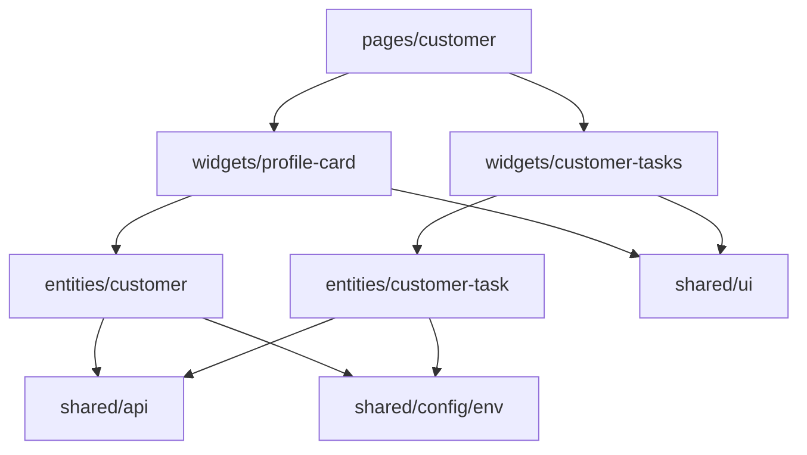

# SPEC-002 — Профиль клиента: карточка клиента и задачи по клиенту

> Бриф: `workshop/briefs/SPEC-002-customer-profile.md`. Дизайн: `docs/design/customer-360.png`
> (блоки «פרטי לקוחה» и «פניות אחרונות»), `docs/design/README.md`.

## 1. Meta

| Поле | Значение |
|---|---|
| ID | SPEC-002 |
| Название | Профиль клиента: карточка клиента и задачи по клиенту |
| Трек | full (epic + tasks + plan) |
| Статус | draft |
| Версия | 1 |
| Создана | 2026-11-09 |
| Владелец | ведущий курса |

Статус: `draft` → `approved` → `in-progress` → `done`. Перевод в `approved` делает
человек. Задачи по эпику в статусе `draft` не нарезаются.

## 2. Суть

Страница `/customers/:customerId` после SPEC-001 показывает только заголовок. Строим два
независимых блока: карточку клиента (аватар, имя, номер, телефон, почта, город) и
карточку задач по клиенту (текст и статус «открыта / выполнена»). Данные приходят из
открытого API DummyJSON. Ответ профиля содержит поля, которые показывать нельзя
(`password`, `ssn`, `bank`, …), поэтому граница слоя данных — белый список.

## 3. Цель

Сотрудник открывает `/customers/N` и за секунду видит, с кем говорит и какие задачи по
клиенту открыты. Страница корректно ведёт себя при загрузке, отсутствии клиента, ошибке
сервера и неожиданном ответе, а чувствительные поля API нигде не появляются.

## 4. Пользователи и сценарии

- **US-1** — Как сотрудник сервисного центра во время звонка, я хочу видеть имя, номер
  клиента, телефон, почту и город, чтобы сразу понять, с кем разговариваю.
- **US-2** — Как сотрудник, я хочу видеть задачи по клиенту и их статус, чтобы знать, что
  по нему ещё открыто.
- **US-3** — Как сотрудник, быстро переключающийся между клиентами, я хочу, чтобы на
  экране всегда был текущий клиент, а не данные предыдущего.
- **US-4** — Как сотрудник, при сбое сервера я хочу сообщение и кнопку «נסו שוב», чтобы
  повторить запрос, не перезагружая страницу.

## 5. Функциональные требования

- **FR-1** — Клиент определяется сегментом `:customerId` адреса. Допустимый идентификатор —
  целое положительное число (§7). Для недопустимого запрос к серверу не отправляется,
  страница показывает «הלקוח לא נמצא».
- **FR-2** — Карточка клиента загружает `GET /users/{id}` и показывает: аватар, полное имя,
  номер клиента, телефон, почту, город.
- **FR-3** — Карточка задач загружает `GET /users/{id}/todos` и показывает для каждой
  задачи текст и статус «פתוח» или «בוצע». Если задач нет — «אין משימות ללקוח».
- **FR-4** — Каждая карточка показывает состояния: загрузка; клиент не найден (`404`);
  ошибка загрузки (сеть, не-2xx, неожиданная форма ответа) с кнопкой «נסו שוב»,
  повторяющей запрос этой карточки.
- **FR-5** — Карточки независимы: сбой или ожидание одной не скрывает и не блокирует
  другую.
- **FR-6** — Аватар — изображение, только если адрес начинается с `https://`. Иначе, и
  если изображение не загрузилось, — инициалы клиента.
- **FR-7** — Слой данных отдаёт только поля белого списка (§7). Остальные поля ответа не
  попадают ни в модель, ни на экран, ни в логи.
- **FR-8** — Запрос отменяется при смене клиента и размонтировании; поздний ответ по
  прежнему клиенту не перезаписывает данные текущего. При смене клиента данные прежнего
  не показываются, пока грузится новый.

## 6. UX и дизайн

Референс: скриншот `docs/design/customer-360.png` — блок профиля (аватар, имя,
телефон) и блок «פניות אחרונות» (карточка со списком). Классы HTML-референса (только
`grep`): `.card`, `.profile-card`, `.profile*`, `.status*`, `.skeleton`, `.empty-state`,
`.error-state` (`docs/design/README.md`).

- Две карточки под заголовком страницы. Точная раскладка по сетке — решение
  исполнителя в пределах токенов; на скриншоте блоки «פרטי לקוחה» и «פניות אחרונות» лежат
  в разных колонках.
- Блоки скриншота, которых нет в брифе (год присоединения, «מבוטחת פעילה», кнопка
  WhatsApp, поиск, претензия и т. д.), **не реализуются**.
- Статус задачи передаётся текстом, не только цветом: «פתוח» — `--warning*`, «בוצע» —
  `--success*`.
- Состояния загрузки, пусто и ошибки скриншотом не показаны; берутся из `.skeleton`,
  `.empty-state`, `.error-state` референса.

| Назначение | Текст |
|---|---|
| Заголовок карточки клиента | פרטי לקוח |
| Подписи полей | מס׳ לקוח · טלפון · דוא״ל · עיר |
| Загрузка карточки клиента | טוען פרטי לקוח |
| Заголовок карточки задач | משימות טיפול |
| Статусы задачи | פתוח · בוצע |
| Загрузка задач | טוען משימות |
| Нет задач | אין משימות ללקוח |
| Клиент не найден | הלקוח לא נמצא |
| Ошибка загрузки | לא הצלחנו לטעון את הנתונים |
| Повторить | נסו שוב |

Все строки — в `src/shared/i18n/he.ts`, без литералов в компонентах и тестах.

## 7. Данные и контракты

### Внешний API

База — `env.apiBaseUrl` (`VITE_API_BASE_URL`).

```
GET /users/{id}
  Успех:   200 → объект пользователя. Используются: id, firstName, lastName, phone,
           email, image, address.city. Прочие поля — недоверенные, не используются.
  Ошибки:  404 — клиента нет; прочие не-2xx — ошибка сервера

GET /users/{id}/todos
  Успех:   200 → { todos: [{ id, todo, completed, userId }], total, skip, limit }
           todos может быть пустым массивом
  Ошибки:  404 — клиента нет; прочие не-2xx — ошибка сервера
```

`id` в пути — только прошедший проверку `^[1-9][0-9]*$` и `Number.isSafeInteger`.
Допустимы: `1`, `42`. Недопустимы (запрос не уходит): `abc`, `0`, `-1`, `1.5`, `007`,
`1e3`, пустая строка.

### Модель приложения

```ts
interface Customer {
  id: number
  firstName: string
  lastName: string
  phone: string
  email: string
  city: string
  avatarUrl: string | null // только https://, иначе null
}

interface CustomerTask {
  id: number
  text: string
  isCompleted: boolean
}

type LoadState<T> =
  | { status: 'loading' }
  | { status: 'success'; data: T }
  | { status: 'not-found' }
  | { status: 'error' }

interface ILoadResult<T> {
  state: LoadState<T>
  retry: () => void
}
// useCustomer(customerId: number): ILoadResult<Customer>
// useCustomerTasks(customerId: number): ILoadResult<CustomerTask[]>
```

Контракт HTTP-клиента (`shared/api`): ответ не-2xx — типизированное исключение со
статусом; сетевой сбой и невалидный JSON — типизированное исключение; поддерживает
`AbortSignal`. Сырой ответ маппер получает как `unknown`.

### Маппинг

| Поле модели | Источник в ответе API | Правило |
|---|---|---|
| `Customer.id` | `id` | обязательное, целое > 0 |
| `Customer.firstName` | `firstName` | обязательное, непустая строка |
| `Customer.lastName` | `lastName` | обязательное, непустая строка |
| `Customer.phone` | `phone` | обязательное, непустая строка |
| `Customer.email` | `email` | обязательное, непустая строка |
| `Customer.city` | `address.city` | обязательное, непустая строка; `address` — объект |
| `Customer.avatarUrl` | `image` | необязательное; строка с префиксом `https://` → она же, иначе `null` |
| `CustomerTask.id` | `todos[].id` | обязательное, целое |
| `CustomerTask.text` | `todos[].todo` | обязательное, строка |
| `CustomerTask.isCompleted` | `todos[].completed` | обязательное, boolean |

Нарушение правила обязательного поля, `todos` не массив, корень не объект — ошибка
(`state: 'error'`), не пустая модель. Модель собирается по одному полю; спред сырого
ответа запрещён.

**Поля ответа, которые не должны покидать слой данных:** `password`, `ssn`, `bank`
(номер карты, IBAN), `ip`, `macAddress`, `crypto`, а также `userId` задач и любые
поля сверх таблицы.

## 8. Архитектура

Слои по `docs/architecture/conventions.md § 1`. Слайсы одного слоя друг друга не
импортируют, поэтому задачи — отдельная сущность.

| Слой | Слайс | Содержимое |
|---|---|---|
| shared | `api` | HTTP-клиент: `AbortSignal`, типизированные ошибки |
| shared | `ui` | универсальные `Card`, `StatusBadge`, `Avatar` (картинка с откатом на инициалы), индикатор загрузки; без слов предметной области |
| shared | `i18n/he.ts` | все строки §6 |
| entities | `customer` | `api`, `model` (`Customer`, маппер, `useCustomer`) |
| entities | `customer-task` | `api`, `model` (`CustomerTask`, маппер, `useCustomerTasks`) |
| widgets | `profile-card` | карточка клиента, все состояния |
| widgets | `customer-tasks` | карточка задач, все состояния |
| pages | `customer` | разбор `customerId`, композиция двух виджетов, сообщение для недопустимого id |



Параллельность: `he.ts`, `shared/api` и `shared/ui` — общий фундамент, который пишется
до виджетов (один файл `he.ts` не правится двумя задачами сразу). Две сущности и два
виджета друг от друга не зависят.

## 9. Нефункциональные требования

- **Доступность:** загрузка — `role="status"` и `aria-busy`; ошибка — `role="alert"`;
  кнопка «נסו שוב» — `button` с доступным именем; заголовки карточек — `h2`; изображение
  аватара не дублирует имя (`alt=""`).
- **RTL и вёрстка:** логические CSS-свойства; телефон и почта отображаются слева направо
  (`dir="ltr"`, выравнивание по началу строки); длинное имя или почта не ломают карточку
  (перенос).
- **Безопасность:** белый список (§7); никаких `console.*` с ответами и ПДн; адрес
  картинки и `id` проверяются; без `dangerouslySetInnerHTML`; новых пакетов нет.
- **Надёжность:** `AbortController` на каждый запрос; отмена — не ошибка и не меняет
  состояние; повторный запрос по «נסו שוב» тоже отменяем.
- **Стили и строки:** цвета, размеры, отступы — только токены; строки — только из `he.ts`.

## 10. Критерии приёмки

Проверяются на уровне поведения. Каждый восходит к требованию.

- **AC-1** — Given адрес `/customers/abc`, `/customers/0`, `/customers/-1`,
  `/customers/1.5`, `/customers/007`, when страница открыта, then виден текст «הלקוח לא נמצא»,
  а `fetch` не вызван ни разу. Given `/customers/1`, then `fetch` вызван. *(FR-1)*
- **AC-2** — Given `/users/1` вернул корректный профиль, when загрузка завершена, then в
  карточке «פרטי לקוח» видны полное имя («имя фамилия»), значения с подписями «מס׳ לקוח»,
  «טלפון», «דוא״ל», «עיר» (номер = `id`, город = `address.city`). *(FR-2)*
- **AC-3** — Given ответы ещё не пришли, then в карточке клиента виден «טוען פרטי לקוח»
  (`role="status"`, `aria-busy`), в карточке задач — «טוען משימות», подписей полей и
  значений нет. После ответа индикатор исчезает. *(FR-4, §9)*
- **AC-4** — Given `/users/1` вернул `404`, then карточка клиента показывает «הלקוח לא נמצא»,
  не показывает кнопку «נסו שוב» и не показывает подписей полей. *(FR-4)*
- **AC-5** — Given сервер вернул `500` или сетевую ошибку, then карточка показывает «לא
  הצלחנו לטעון את הנתונים» (`role="alert"`) и кнопку «נסו שוב»; when кнопка нажата и повторный
  запрос успешен, then ошибка исчезает, показаны данные, а `fetch` вызван повторно с тем
  же адресом. *(FR-4)*
- **AC-6** — Given ответ профиля неожиданной формы (нет `firstName`; `address` отсутствует;
  тело — массив или не JSON; `phone` — число), then показано сообщение об ошибке с «נסו
  שוב», страница не падает, пустая карточка не рисуется. Аналогично для задач: `todos` не
  массив, у элемента нет `todo` или `completed` не boolean. *(FR-4, FR-7)*
- **AC-7** — Given `todos` содержит задачи, then для каждой виден текст и статус:
  `completed: true` → «בוצע», `completed: false` → «פתוח»; задача с `completed: false` не
  помечена «בוצע» и наоборот. *(FR-3)*
- **AC-8** — Given `todos: []`, then виден «אין משימות ללקוח». Given есть хотя бы одна
  задача, then этого текста нет. *(FR-3)*
- **AC-9** — Given запрос задач завершился ошибкой, then карточка клиента показывает данные,
  а карточка задач — ошибку с «נסו שוב»; и наоборот. Повтор в одной карточке не
  перезапрашивает другую. *(FR-5)*
- **AC-10** — Given `image` начинается с `https://`, then в карточке есть изображение. Given
  `image` — `http://…`, `javascript:…`, `data:…`, пустая строка или поле отсутствует, then
  изображения нет, показаны инициалы (первые буквы имени и фамилии). Given изображение не
  загрузилось (`error`), then показаны инициалы. *(FR-6)*
- **AC-11** — Given фикстура профиля содержит `password`, `ssn`, `bank`, `ip`,
  `macAddress`, `crypto`, then их значения не присутствуют в DOM, объект `Customer` из
  маппера имеет ровно ключи `id, firstName, lastName, phone, email, city, avatarUrl`,
  `CustomerTask` — ровно `id, text, isCompleted`, и ни один вызов `console.*` не содержит
  значений этих полей. *(FR-7)*
- **AC-12** — Given открыт клиент 1, ответ которого задерживается, when сотрудник
  переключается на клиента 2, ответ клиента 2 приходит раньше, а затем приходит ответ
  клиента 1, then на экране данные клиента 2 (в обеих карточках). Запрос клиента 1 отменён
  через `AbortSignal`. Размонтирование тоже отменяет запрос без ошибки в консоли. *(FR-8)*
- **AC-13** — Given показан клиент 1, when адрес сменился на клиента 2 и его данные ещё
  грузятся, then данные клиента 1 не видны, показан индикатор загрузки. *(FR-8)*
- **AC-14** — Given код слайсов этой спеки, when выполнен
  `grep -rnP '[\x{0590}-\x{05FF}]' src --include=*.ts --include=*.tsx`, then совпадения
  только в `src/shared/i18n/he.ts`; в новых `*.module.css` нет цветовых литералов (`#`,
  `rgb(`) и числовых `px`/`rem`, кроме объявления токенов. *(§9 Стили и строки)*
- **AC-15** — Given состояние `error`, then есть элемент с `role="alert"`; кнопка «נסו שוב»
  находится по роли `button` и имени; заголовки «פרטי לקוח» и «משימות טיפול» находятся по
  роли `heading`. *(§9 Доступность)*
- **AC-16** — Given реализация завершена, then `npm run validate` зелёный, `package.json` и
  lock-файл не изменены, в `tools/` и `docs/design/` изменений нет. *(§9 Безопасность)*

## 11. Тестирование

- Уровни: юнит-тесты мапперов и валидации `id`/URL; хуки через Testing Library;
  компонентные тесты виджетов; тест страницы на роутере (`MemoryRouter`).
- Сеть не трогаем: `fetch` подменяется через `vi.stubGlobal`. Фикстура профиля содержит
  чувствительные поля (AC-11). Гонку (AC-12) моделируют управляемые промисы.
- Ручная проверка (G9): `npm run dev` и `npm run dev:offline`, адреса `/customers/1`,
  `/customers/9999` (404), `/customers/abc`; сверка со скриншотом.
- Сценарии по задачам — в `tasks.md`.

## 12. Не входит

- Поиск другого клиента (SPEC-003).
- Претензии, полисы, льготы, документирование разговора, предложения.
- Редактирование данных клиента.
- Год присоединения и статус «מבוטחת פעילה» — в API таких полей нет.
- Кэширование, пагинация задач, тёмная тема.
- Блоки скриншота за пределами карточки клиента и списка задач.
- Изменения `tools/`, `docs/design/`, офлайн-копии API.

## 13. Открытые вопросы

1. **Обязательные поля профиля.** Принято: `image` необязателен, остальные шесть
   полей обязательны. Подтвердить.
2. **Один «битый» элемент в `todos`.** Принято: вся карточка задач — ошибка, элемент не
   пропускается молча. Подтвердить.
3. **`404` на запросе задач.** В брифе нет. Принято: карточка задач показывает «הלקוח לא
   נמצא» (без «נסו שוב»), как карточка клиента.
4. **Заголовок карточки.** Скриншот: «פרטי לקוחה» (женский род), бриф: «פרטי לקוח».
   Принят бриф.
5. **Таймаут запроса.** В брифе нет; принято: нет, запрос остаётся в загрузке до отмены
   или ответа.
6. **Инициалы.** Принято: первая буква имени + первая буква фамилии; в данных API — латиница.
7. **Порядок задач и объём.** Принято: порядок ответа API; пагинации нет.
8. **Кнопка «נסו שוב» при `404`.** Принято: нет — повтор не поможет. Подтвердить.
9. **Адаптивность.** Требований в брифе нет; принято: на усмотрение исполнителя в
   пределах токенов.
10. **Размер аватара.** Подходящего токена нет (есть `--icon-xl` 40px и `--space-*`); нужен
    ли новый токен — решение владельца. `tokens.css` лежит вне границ этой спеки.

## 14. Риски и допущения

| Риск / допущение | Что делаем |
|---|---|
| Данные DummyJSON на английском, не иврит | Ожидаемо (`docs/design/README.md`) |
| Публичный API недоступен без сети | `npm run dev:offline` обслуживает оба адреса (`mocks/mockApiPlugin.ts`) |
| Два виджета пишутся параллельно и оба правят `he.ts` | Строки добавляются одной фундаментальной задачей до виджетов |
| Строгая проверка `id` отсекает `007` | Фиксируем в AC-1: такой адрес — «клиент не найден» |
