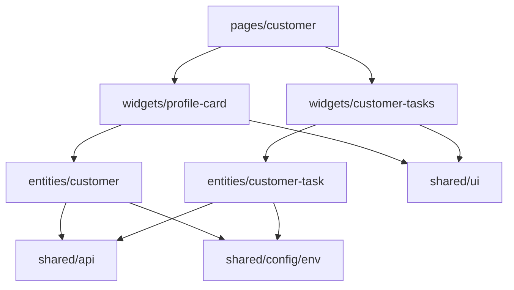

# SPEC-002 — Customer profile: customer card and customer tasks

> Brief: `workshop/briefs/SPEC-002-customer-profile.md`. Design: `docs/design/customer-360.png`
> (the "פרטי לקוחה" and "פניות אחרונות" blocks), `docs/design/README.md`.

## 1. Meta

| Field | Value |
|---|---|
| ID | SPEC-002 |
| Title | Customer profile: customer card and customer tasks |
| Track | full (epic + tasks + plan) |
| Status | draft |
| Version | 1 |
| Created | 2026-11-09 |
| Owner | course lead |

Status: `draft` → `approved` → `in-progress` → `done`. Moving to `approved` is done by
a human. An epic in `draft` status is not broken down into tasks.

## 2. Summary

After SPEC-001 the page `/customers/:customerId` shows only a heading. We build two
independent blocks: a customer card (avatar, name, number, phone, email, city) and a
customer-tasks card (text and an "open / done" status). Data comes from the public
DummyJSON API. The profile response contains fields that must not be shown
(`password`, `ssn`, `bank`, …), so the data-layer boundary is an allowlist.

## 3. Goal

An employee opens `/customers/N` and within a second sees who they are talking to and
which tasks for that customer are open. The page behaves correctly while loading, when the
customer is missing, on a server error and on an unexpected response, and sensitive API
fields never appear anywhere.

## 4. Users and scenarios

- **US-1** — As a service-centre employee on a call, I want to see the customer's name,
  number, phone, email and city so that I immediately understand who I am talking to.
- **US-2** — As an employee, I want to see the customer's tasks and their status so that I
  know what is still open for them.
- **US-3** — As an employee switching quickly between customers, I want the screen to
  always show the current customer, not the previous one's data.
- **US-4** — As an employee, when the server fails I want a message and a "נסו שוב" button
  so that I can retry the request without reloading the page.

## 5. Functional requirements

- **FR-1** — The customer is identified by the `:customerId` segment of the URL. A valid
  identifier is a positive integer (§7). For an invalid one no request is sent to the server
  and the page shows "הלקוח לא נמצא".
- **FR-2** — The customer card loads `GET /users/{id}` and shows: avatar, full name,
  customer number, phone, email, city.
- **FR-3** — The tasks card loads `GET /users/{id}/todos` and shows, for each task, its
  text and the status "פתוח" or "בוצע". If there are no tasks — "אין משימות ללקוח".
- **FR-4** — Each card shows the states: loading; customer not found (`404`);
  load error (network, non-2xx, unexpected response shape) with a "נסו שוב" button
  that repeats that card's request.
- **FR-5** — The cards are independent: a failure or wait in one neither hides nor blocks
  the other.
- **FR-6** — The avatar is an image only if its URL starts with `https://`. Otherwise, and
  if the image failed to load, the customer's initials are shown.
- **FR-7** — The data layer returns only allowlisted fields (§7). All other response fields
  reach neither the model, nor the screen, nor the logs.
- **FR-8** — The request is cancelled on customer change and on unmount; a late response
  for the previous customer does not overwrite the current one's data. On customer change
  the previous customer's data is not shown while the new one loads.

## 6. UX and design

Reference: the screenshot `docs/design/customer-360.png` — the profile block (avatar, name,
phone) and the "פניות אחרונות" block (a card with a list). Classes of the HTML reference
(`grep` only): `.card`, `.profile-card`, `.profile*`, `.status*`, `.skeleton`, `.empty-state`,
`.error-state` (`docs/design/README.md`).

- Two cards below the page heading. The exact grid layout is the implementer's decision
  within the design tokens; on the screenshot the "פרטי לקוחה" and "פניות אחרונות" blocks sit
  in different columns.
- Screenshot blocks that are not in the brief (year joined, "מבוטחת פעילה", WhatsApp
  button, search, claim, etc.) are **not implemented**.
- Task status is conveyed by text, not only by colour: "פתוח" — `--warning*`, "בוצע" —
  `--success*`.
- Loading, empty and error states are not shown on the screenshot; they are taken from the
  reference's `.skeleton`, `.empty-state`, `.error-state`.

| Purpose | Text |
|---|---|
| Customer card heading | פרטי לקוח |
| Field labels | מס׳ לקוח · טלפון · דוא״ל · עיר |
| Customer card loading | טוען פרטי לקוח |
| Tasks card heading | משימות טיפול |
| Task statuses | פתוח · בוצע |
| Tasks loading | טוען משימות |
| No tasks | אין משימות ללקוח |
| Customer not found | הלקוח לא נמצא |
| Load error | לא הצלחנו לטעון את הנתונים |
| Retry | נסו שוב |

All strings live in `src/shared/i18n/he.ts`; no literals in components or tests.

## 7. Data and contracts

### External API

Base URL — `env.apiBaseUrl` (`VITE_API_BASE_URL`).

```
GET /users/{id}
  Success: 200 → user object. Used: id, firstName, lastName, phone,
           email, image, address.city. All other fields are untrusted and unused.
  Errors:  404 — no such customer; any other non-2xx — server error

GET /users/{id}/todos
  Success: 200 → { todos: [{ id, todo, completed, userId }], total, skip, limit }
           todos may be an empty array
  Errors:  404 — no such customer; any other non-2xx — server error
```

The `id` in the path must pass `^[1-9][0-9]*$` and `Number.isSafeInteger`.
Valid: `1`, `42`. Invalid (no request is sent): `abc`, `0`, `-1`, `1.5`, `007`,
`1e3`, empty string.

### Application model

```ts
interface Customer {
  id: number
  firstName: string
  lastName: string
  phone: string
  email: string
  city: string
  avatarUrl: string | null // https:// only, otherwise null
}

interface CustomerTask {
  id: number
  text: string
  isCompleted: boolean
}

type LoadState<T> =
  | { status: 'loading' }
  | { status: 'success'; data: T }
  | { status: 'not-found' }
  | { status: 'error' }

interface ILoadResult<T> {
  state: LoadState<T>
  retry: () => void
}
// useCustomer(customerId: number): ILoadResult<Customer>
// useCustomerTasks(customerId: number): ILoadResult<CustomerTask[]>
```

HTTP client contract (`shared/api`): a non-2xx response is a typed exception carrying the
status; a network failure and invalid JSON are typed exceptions; it supports
`AbortSignal`. The mapper receives the raw response as `unknown`.

### Mapping

| Model field | Source in API response | Rule |
|---|---|---|
| `Customer.id` | `id` | required, integer > 0 |
| `Customer.firstName` | `firstName` | required, non-empty string |
| `Customer.lastName` | `lastName` | required, non-empty string |
| `Customer.phone` | `phone` | required, non-empty string |
| `Customer.email` | `email` | required, non-empty string |
| `Customer.city` | `address.city` | required, non-empty string; `address` must be an object |
| `Customer.avatarUrl` | `image` | optional; string with `https://` prefix → as is, otherwise `null` |
| `CustomerTask.id` | `todos[].id` | required, integer |
| `CustomerTask.text` | `todos[].todo` | required, string |
| `CustomerTask.isCompleted` | `todos[].completed` | required, boolean |

A violated required-field rule, `todos` not an array, or a non-object root is an error
(`state: 'error'`), not an empty model. The model is built field by field; spreading the
raw response is forbidden.

**Response fields that must not leave the data layer:** `password`, `ssn`, `bank`
(card number, IBAN), `ip`, `macAddress`, `crypto`, plus the tasks' `userId` and any
field beyond the table.

## 8. Architecture

Layers per `docs/architecture/conventions.md § 1`. Slices of the same layer do not import
each other, so tasks are a separate entity.

| Layer | Slice | Contents |
|---|---|---|
| shared | `api` | HTTP client: `AbortSignal`, typed errors |
| shared | `ui` | generic `Card`, `StatusBadge`, `Avatar` (image with fallback to initials), loading indicator; no domain vocabulary |
| shared | `i18n/he.ts` | all strings from §6 |
| entities | `customer` | `api`, `model` (`Customer`, mapper, `useCustomer`) |
| entities | `customer-task` | `api`, `model` (`CustomerTask`, mapper, `useCustomerTasks`) |
| widgets | `profile-card` | customer card, all states |
| widgets | `customer-tasks` | tasks card, all states |
| pages | `customer` | `customerId` parsing, composition of the two widgets, message for an invalid id |



Parallelism: `he.ts`, `shared/api` and `shared/ui` are the shared foundation, written
before the widgets (the single file `he.ts` is not edited by two tasks at once). The two
entities and the two widgets do not depend on each other.

## 9. Non-functional requirements

- **Accessibility:** loading — `role="status"` and `aria-busy`; error — `role="alert"`;
  the "נסו שוב" button — a `button` with an accessible name; card headings — `h2`; the
  avatar image does not duplicate the name (`alt=""`).
- **RTL and layout:** logical CSS properties; phone and email are displayed left to right
  (`dir="ltr"`, aligned to the line start); a long name or email does not break the card
  (wrapping).
- **Security:** allowlist (§7); no `console.*` with responses or personal data; the image
  URL and `id` are validated; no `dangerouslySetInnerHTML`; no new packages.
- **Reliability:** an `AbortController` per request; cancellation is not an error and does
  not change state; the repeated request on "נסו שוב" is cancellable too.
- **Styles and strings:** colours, sizes, spacing — design tokens only; strings — from `he.ts` only.

## 10. Acceptance criteria

Verified at the behaviour level. Each traces back to a requirement.

- **AC-1** — Given the URL `/customers/abc`, `/customers/0`, `/customers/-1`,
  `/customers/1.5`, `/customers/007`, when the page is open, then the text "הלקוח לא נמצא" is
  visible and `fetch` was never called. Given `/customers/1`, then `fetch` was called. *(FR-1)*
- **AC-2** — Given `/users/1` returned a valid profile, when loading has finished, then the
  "פרטי לקוח" card shows the full name ("first last") and values with the labels "מס׳ לקוח",
  "טלפון", "דוא״ל", "עיר" (number = `id`, city = `address.city`). *(FR-2)*
- **AC-3** — Given the responses have not arrived yet, then the customer card shows "טוען פרטי לקוח"
  (`role="status"`, `aria-busy`), the tasks card shows "טוען משימות", and there are no field
  labels or values. After the response the indicator disappears. *(FR-4, §9)*
- **AC-4** — Given `/users/1` returned `404`, then the customer card shows "הלקוח לא נמצא",
  shows no "נסו שוב" button and shows no field labels. *(FR-4)*
- **AC-5** — Given the server returned `500` or a network error, then the card shows "לא
  הצלחנו לטעון את הנתונים" (`role="alert"`) and a "נסו שוב" button; when the button is pressed and
  the repeated request succeeds, then the error disappears, the data is shown, and `fetch` was
  called again with the same URL. *(FR-4)*
- **AC-6** — Given a profile response of unexpected shape (no `firstName`; `address` missing;
  body is an array or not JSON; `phone` is a number), then an error message with "נסו
  שוב" is shown, the page does not crash, and no empty card is rendered. Likewise for tasks:
  `todos` not an array, an item without `todo`, or `completed` not a boolean. *(FR-4, FR-7)*
- **AC-7** — Given `todos` contains tasks, then each shows its text and status:
  `completed: true` → "בוצע", `completed: false` → "פתוח"; a task with `completed: false` is not
  marked "בוצע" and vice versa. *(FR-3)*
- **AC-8** — Given `todos: []`, then "אין משימות ללקוח" is visible. Given at least one
  task, then that text is absent. *(FR-3)*
- **AC-9** — Given the tasks request failed, then the customer card shows data
  and the tasks card shows an error with "נסו שוב"; and vice versa. Retrying in one card does
  not re-request the other. *(FR-5)*
- **AC-10** — Given `image` starts with `https://`, then the card contains an image. Given
  `image` is `http://…`, `javascript:…`, `data:…`, an empty string or the field is missing, then
  there is no image and the initials are shown (first letters of first and last name). Given the
  image failed to load (`error`), then the initials are shown. *(FR-6)*
- **AC-11** — Given the profile fixture contains `password`, `ssn`, `bank`, `ip`,
  `macAddress`, `crypto`, then their values are absent from the DOM, the `Customer` object from
  the mapper has exactly the keys `id, firstName, lastName, phone, email, city, avatarUrl`,
  `CustomerTask` — exactly `id, text, isCompleted`, and no `console.*` call contains
  the values of those fields. *(FR-7)*
- **AC-12** — Given customer 1 is open and its response is delayed, when the employee
  switches to customer 2, customer 2's response arrives first, and then customer 1's response
  arrives, then the screen shows customer 2's data (in both cards). Customer 1's request was
  cancelled via `AbortSignal`. Unmounting also cancels the request without a console error. *(FR-8)*
- **AC-13** — Given customer 1 is shown, when the URL changed to customer 2 and their data is
  still loading, then customer 1's data is not visible and the loading indicator is shown. *(FR-8)*
- **AC-14** — Given the code of this spec's slices, when
  `grep -rnP '[\x{0590}-\x{05FF}]' src --include=*.ts --include=*.tsx` is run, then matches
  are only in `src/shared/i18n/he.ts`; new `*.module.css` files contain no colour literals (`#`,
  `rgb(`) and no numeric `px`/`rem`, except token declarations. *(§9 Styles and strings)*
- **AC-15** — Given the `error` state, then there is an element with `role="alert"`; the "נסו שוב"
  button is found by role `button` and name; the headings "פרטי לקוח" and "משימות טיפול" are found by
  role `heading`. *(§9 Accessibility)*
- **AC-16** — Given the implementation is complete, then `npm run validate` is green, `package.json` and
  the lock file are unchanged, and there are no changes in `tools/` and `docs/design/`. *(§9 Security)*

## 11. Testing

- Levels: unit tests for the mappers and `id`/URL validation; hooks via Testing Library;
  component tests for the widgets; a page test on the router (`MemoryRouter`).
- No network access: `fetch` is replaced via `vi.stubGlobal`. The profile fixture contains
  sensitive fields (AC-11). The race (AC-12) is modelled with controlled promises.
- Manual check (G9): `npm run dev` and `npm run dev:offline`, URLs `/customers/1`,
  `/customers/9999` (404), `/customers/abc`; comparison with the screenshot.
- Per-task scenarios are in `tasks.md`.

## 12. Out of scope

- Searching for another customer (SPEC-003).
- Claims, policies, benefits, call documentation, offers.
- Editing customer data.
- Year joined and the "מבוטחת פעילה" status — the API has no such fields.
- Caching, task pagination, dark theme.
- Screenshot blocks beyond the customer card and the task list.
- Changes to `tools/`, `docs/design/`, the offline API copy.

## 13. Open questions

1. **Required profile fields.** Decided: `image` is optional, the other six
   fields are required. To confirm.
2. **A single "broken" item in `todos`.** Decided: the whole tasks card is an error; the item is
   not silently skipped. To confirm.
3. **`404` on the tasks request.** Not in the brief. Decided: the tasks card shows "הלקוח לא
   נמצא" (without "נסו שוב"), like the customer card.
4. **Card heading.** Screenshot: "פרטי לקוחה" (feminine), brief: "פרטי לקוח".
   Resolved in favour of the brief.
5. **Request timeout.** Not in the brief; decided: none, the request stays in loading until
   cancelled or answered.
6. **Initials.** Decided: first letter of the first name + first letter of the last name; API data is in Latin script.
7. **Task order and volume.** Decided: API response order; no pagination.
8. **"נסו שוב" button on `404`.** Decided: none — retrying will not help. To confirm.
9. **Responsiveness.** No requirements in the brief; decided: at the implementer's discretion
   within the design tokens.
10. **Avatar size.** There is no suitable token (there are `--icon-xl` 40px and `--space-*`); whether
    a new token is needed is the owner's decision. `tokens.css` lies outside this spec's boundaries.

## 14. Risks and assumptions

| Risk / assumption | What we do |
|---|---|
| DummyJSON data is in English, not Hebrew | Expected (`docs/design/README.md`) |
| The public API is unavailable without network | `npm run dev:offline` serves both URLs (`mocks/mockApiPlugin.ts`) |
| Two widgets are written in parallel and both edit `he.ts` | Strings are added by one foundation task before the widgets |
| Strict `id` validation rejects `007` | Fixed in AC-1: such a URL is "customer not found" |
