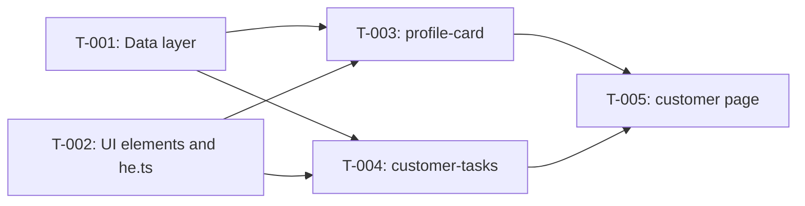

# SPEC-002 — Execution plan

## 1. Meta

| Field | Value |
|---|---|
| Epic | [SPEC-002: Customer profile: customer card and customer tasks](./epic.md) |
| Tasks | [tasks.md](./tasks.md) |
| Status | not-started |
| Created | 2026-11-09 |
| Implementer | the `react-engineer` agent |
| Stop mode | per-wave — pause after every wave |
| Parallelism | at most 3 agents per wave |
| Review | independent, `/review`; at most 2 rounds |

Status: `not-started` → `in-progress` → `completed` / `blocked`. Written by the orchestrator.

## 2. Summary

- **Tasks:** 5
- **Waves:** 3
- **Critical path:** 3 tasks

The foundation is two independent tasks: the data layer (T-001) and the shared UI elements with
the string dictionary (T-002). Work then fans out in parallel to two widgets (T-003, T-004), which
do not depend on each other, and converges in a single page-assembly task (T-005).
`src/shared/i18n/he.ts` is edited only by T-002.

## 3. Dependency graph

Arrow: source blocks target.

## 4. Critical path

`T-001 → T-003 → T-005` (equivalent via T-004; T-001 and T-002 are both size M).

Parallelism does not shorten this chain — blockers on it are watched first.
The riskiest node is T-001 (upper bound of M, three modules).

## 5. Dry run: conflicts before start

### Path overlaps within a wave

| Wave | Tasks | Shared path | Risk | Resolution |
|---|---|---|---|---|
| 1 | T-001, T-002 | none (`shared/api`, `entities/*` vs `shared/ui/*`, `he.ts`) | — | — |
| 2 | T-003, T-004 | none (`widgets/profile-card` vs `widgets/customer-tasks`) | — | `he.ts` and `shared/ui` are read-only in wave 2 |
| 3 | T-005 | — (single task) | — | — |

Shared files outside the task paths: `src/shared/ui/index.ts` — T-002 only; `package.json`,
the lock file — nobody. During a parallel wave `npm run validate` may show a type or lint
error in someone else's not-yet-finished file — implementers report it, they do not fix it.

### External dependencies

- **Packages:** no new ones.
- **Environment variables:** `VITE_API_BASE_URL` — already exists, read only in `shared/config/env.ts`.
- **External services:** DummyJSON; without network — `npm run dev:offline`. Tests do not touch the network.

## 6. Waves

### Wave 1 — Foundation

- **Tasks:** T-001, T-002
- **In parallel:** 2 agents
- **Check at the end:** `npm run validate`
- **Expected outcome:** the `useCustomer` and `useCustomerTasks` hooks with tests; `Card`,
  `StatusBadge`, `Avatar`, `Loader` in `@/shared/ui`; all epic §6 strings in `he.ts`.

### Wave 2 — Widgets

- **Tasks:** T-003, T-004
- **In parallel:** 2 agents
- **Waits for:** wave 1
- **Check at the end:** `npm run validate`
- **Expected outcome:** `ProfileCard` and `CustomerTasks` with all states, covered by
  tests; not yet wired into the page.

### Wave 3 — Page assembly

- **Tasks:** T-005
- **Waits for:** wave 2
- **Check at the end:** `npm run validate`, the `grep` from epic AC-14, `git status` for `package.json`,
  the lock file, `tools/`, `docs/design/`
- **Expected outcome:** `/customers/N` shows two cards; an invalid id yields
  "הלקוח לא נמצא" without a request; the SPEC-001 shell tests pass with the `fetch` stub.

## 7. Gates

Before each row was written, the tool was verified to exist.

| Gate | When | How | Wired up |
|---|---|---|---|
| G4 Task DoD | after every task | `npm run validate` + hand-off | yes (`.github/agents/react-engineer.agent.md` exists) |
| G5 Review | after the last wave | `/review` → `/sdd fix`, up to 2 rounds | check before start: `.github/agents/code-reviewer.agent.md` exists |
| G6 Security | after `APPROVED` | `/security-review`, `npm run audit:deps` | yes (`git rev-parse --verify main` passes) |
| G7 Spec close | after security | `/sdd close` | yes |
| G8 Build | in `/sdd close` | `npm run release:check` | yes |
| G9 Release | at the end | `npm run preview` + manual check | yes |

## 8. Execution risks

| Risk | Likelihood | What we do |
|---|---|---|
| T-001 does not fit in M | medium | the implementer stops and reports; the orchestrator splits the task, not the implementer |
| External API unreachable from the network | medium | `npm run dev:offline`; tests do not touch the network |
| The shared `useAsyncResource` hook extends epic §8 | low | record the owner's decision before wave 1 starts |
| Avatar size has no token (epic §13 item 10) | low | temporarily `--space-16`; owner's decision |
| `App.test.tsx` hits the network after page assembly | high | covered in T-005 (`fetch` stub, previous assertions unchanged) |

## 9. Progress log

Written only by the orchestrator — implementers return their row in the hand-off.

| Task | Wave | Started | Completed | Status | Gate | Notes |
|---|---|---|---|---|---|---|
| T-001 | 1 | | | not-started | | |
| T-002 | 1 | | | not-started | | |
| T-003 | 2 | | | not-started | | |
| T-004 | 2 | | | not-started | | |
| T-005 | 3 | | | not-started | | |
