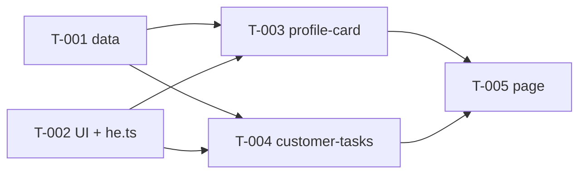

# SPEC-002 — Tasks

**Epic:** [SPEC-002: Customer profile: customer card and customer tasks](./epic.md)
**Status:** not-started
**Created:** 2026-11-09

## Task index

| ID | Title | Type | Size | Status | Blocked by | Blocks |
|---|---|---|---|---|---|---|
| T-001 | Data layer: HTTP client, loading hook, `customer` and `customer-task` entities | feature | M | not-started | — | T-003, T-004 |
| T-002 | Shared UI elements and string dictionary | feature | M | not-started | — | T-003, T-004 |
| T-003 | `profile-card` widget | feature | M | not-started | T-001, T-002 | T-005 |
| T-004 | `customer-tasks` widget | feature | M | not-started | T-001, T-002 | T-005 |
| T-005 | `customer` page: id parsing and assembly | feature | S | not-started | T-003, T-004 | — |

Size: `S` — one component or module; `M` — several files, small design
decisions. T-001 is the upper bound of `M` (three modules in three slices); if the implementer
runs out of room, they stop and report rather than cutting corners.

Status: `not-started` → `in-progress` → `completed` / `blocked`.

## Dependency graph



Waves: **1** — T-001 ∥ T-002; **2** — T-003 ∥ T-004; **3** — T-005.
`src/shared/i18n/he.ts` is edited only by T-002.

## Epic AC traceability

Every epic AC is assigned to at least one task. The first task listed is the one whose test
is primary; the others verify their own part.

| Epic AC | Tasks |
|---|---|
| AC-1 | T-005 (id parsing), T-001 (id guard in the request) |
| AC-2 | T-003 |
| AC-3 | T-003, T-004, T-002 (indicator) |
| AC-4 | T-003, T-004, T-001 (`404` → `not-found`) |
| AC-5 | T-003, T-004, T-001 (`retry`) |
| AC-6 | T-001 (mapper), T-003, T-004 |
| AC-7 | T-004, T-002 (`StatusBadge`) |
| AC-8 | T-004 |
| AC-9 | T-005, T-003, T-004 |
| AC-10 | T-001 (`avatarUrl`), T-002 (fallback on `error`), T-003 |
| AC-11 | T-001 (model keys, logs), T-003, T-004 (DOM) |
| AC-12 | T-001 (hook), T-005 (page) |
| AC-13 | T-001 (hook), T-005 (page) |
| AC-14 | T-002, T-003, T-004, T-005 (final `grep`) |
| AC-15 | T-002, T-003, T-004 |
| AC-16 | T-005 (final check), all tasks (do not touch `package.json`) |

---

## T-001: Data layer — HTTP client, loading hook, entities

### Meta

| Field | Value |
|---|---|
| Type | feature |
| Size | M |
| Status | not-started |
| Scope paths | `src/shared/api/**`, `src/entities/customer/**`, `src/entities/customer-task/**` |
| Blocked by | — |
| Blocks | T-003, T-004 |
| Epic sections | §5 FR-1 (id guard), FR-2, FR-3, FR-4, FR-7, FR-8; §7; §9 Security, Reliability; §10 AC-4, AC-5, AC-6, AC-10, AC-11, AC-12, AC-13 |

### Goal

`useCustomer(id)` and `useCustomerTasks(id)` return the `LoadState` discriminated union,
build the model via an allowlist, cancel requests and do not show the previous customer's data.

### Context

The data foundation. Widgets T-003 and T-004 take only the hooks and model types from it.
There are no UI strings here, so `he.ts` is not touched.

### In scope

- `shared/api`: HTTP client, typed errors, id validation, the `LoadState` /
  `ILoadResult` types, the shared loading hook `useAsyncResource` (cancellation, race, `retry`) —
  so that the `AbortController` logic lives in one place instead of being copied into two entities.
- `entities/customer`: request, `Customer` type, mapper, `useCustomer`.
- `entities/customer-task`: request, `CustomerTask` type, mapper, `useCustomerTasks`.
- Unit tests for the mappers, the client, the hooks.

### Out of scope

- Components, CSS, strings, `he.ts` (T-002 and the widgets).
- Computing initials (T-003).
- Parsing `:customerId` from the URL (T-005): here only the guard on the request itself.
- New packages, changes to `env.ts`.

### Contracts

```ts
// shared/api/index.ts — the slice's public API
export class HttpError extends Error { readonly status: number }   // non-2xx response
export class NetworkError extends Error {}                          // network failure
export class ParseError extends Error {}                            // invalid JSON
export function getJson(path: string, options?: { signal?: AbortSignal }): Promise<unknown>
// URL = env.apiBaseUrl + path (env from '@/shared/config/env'). Cancellation: the promise
// rejects with AbortError, not wrapped in NetworkError.
export function isAbortError(error: unknown): boolean

export function parseResourceId(raw: string | undefined): number | null
// ^[1-9][0-9]*$ and Number.isSafeInteger → number, otherwise null.
// Valid: '1', '42'. Invalid: 'abc','0','-1','1.5','007','1e3','', undefined.
export function isResourceId(value: number): boolean   // integer > 0, safe integer

export type LoadState<T> =
  | { status: 'loading' }
  | { status: 'success'; data: T }
  | { status: 'not-found' }
  | { status: 'error' }
export interface ILoadResult<T> { state: LoadState<T>; retry: () => void }

export function useAsyncResource<T>(
  key: number,
  load: (signal: AbortSignal) => Promise<T>,
): ILoadResult<T>
// - first render and any key change: state = loading already in that same render
//   (the previous key's data is not shown for even one frame);
// - HttpError 404 → not-found; any other error (HttpError, NetworkError,
//   ParseError, mapper error) → error; AbortError is ignored;
// - on key change and on unmount the request is cancelled; a late response is not
//   written; retry() cancels the current request and starts a new one.

// entities/customer/index.ts
export interface Customer {
  id: number; firstName: string; lastName: string
  phone: string; email: string; city: string
  avatarUrl: string | null            // https:// only, otherwise null
}
export function useCustomer(customerId: number): ILoadResult<Customer>
// GET /users/{id}. The mapper takes unknown and is not exported from index.ts.

// entities/customer-task/index.ts
export interface CustomerTask { id: number; text: string; isCompleted: boolean }
export function useCustomerTasks(customerId: number): ILoadResult<CustomerTask[]>
// GET /users/{id}/todos → { todos: [...] }. The mapper takes unknown.
```

Mapping table (from epic §7):

| Model field | Source | Rule |
|---|---|---|
| `Customer.id` | `id` | required, integer > 0 |
| `firstName`, `lastName`, `phone`, `email` | same-named | required, non-empty string |
| `city` | `address.city` | required, non-empty string; `address` must be an object |
| `avatarUrl` | `image` | optional; string with `https://` → as is, otherwise `null` |
| `CustomerTask.id` | `todos[].id` | required, integer |
| `text` | `todos[].todo` | required, string |
| `isCompleted` | `todos[].completed` | required, boolean |

Any violation, `todos` not an array, or a non-object root is an error. The model is built
field by field; spreading the raw response is forbidden. The entities' request functions throw
`RangeError` if `isResourceId(customerId)` is false — no request is sent.
Must not leave the layer: `password`, `ssn`, `bank`, `ip`, `macAddress`, `crypto`, the tasks'
`userId` and any field beyond the table. Responses and personal data are not written to `console.*`.

### Files

| Path | Action | Purpose |
|---|---|---|
| `src/shared/api/httpClient.ts`, `errors.ts`, `resourceId.ts`, `useAsyncResource.ts`, `types.ts`, `index.ts` | create (remove `.gitkeep`) | client, errors, id, hook, types |
| `src/shared/api/__tests__/*.test.ts(x)` | create | client, `parseResourceId`, hook |
| `src/entities/customer/{api,model}/…`, `index.ts` | create | request, `Customer`, mapper, `useCustomer` |
| `src/entities/customer/__tests__/*` | create | mapper, hook |
| `src/entities/customer-task/{api,model}/…`, `index.ts` | create | same for tasks |
| `src/entities/customer-task/__tests__/*` | create | mapper, hook |

### Acceptance criteria

- **AC-1** — `getJson` throws `HttpError` with the status on non-2xx, `NetworkError` on a
  network failure, `ParseError` on invalid JSON; cancellation — `AbortError`. *(epic AC-4, AC-5, AC-12)*
- **AC-2** — `parseResourceId` accepts `'1'`, `'42'` and returns `null` for every
  invalid value from the contract; an entity request with an invalid id does not call `fetch`. *(epic AC-1)*
- **AC-3** — The mappers return a model with exactly the keys `id, firstName, lastName, phone, email,
  city, avatarUrl` and `id, text, isCompleted`; the fixture's sensitive values appear nowhere
  in the model; no `console.*` is called with the values of those fields. *(epic AC-11)*
- **AC-4** — Every violation of the mapping rules (no `firstName`; `address` missing;
  `phone` is a number; root is an array; `todos` not an array; no `todo`; `completed` not a boolean)
  yields `error`. *(epic AC-6)*
- **AC-5** — `image`: `https://…` → URL; `http://…`, `javascript:…`, `data:…`, `''`,
  missing → `null`. *(epic AC-10)*
- **AC-6** — Hooks: `404` → `not-found`, `500`/network → `error`; `retry()` repeats the request to
  the same URL and leads to `success`. *(epic AC-4, AC-5)*
- **AC-7** — Race: a response for the previous id arriving after the response for the new one does not
  change state; the previous id's request is cancelled via `AbortSignal`; on id change `state` is `loading`
  in the same render; unmount cancels the request, no console errors. *(epic AC-12, AC-13)*

### Tests

**Main scenarios:**

- **S-1** — Given a profile fixture with all sensitive fields, when `mapCustomer`,
  then the model keys are exactly the allowlist, the values of `password/ssn/bank/…` are not found
  in `JSON.stringify(model)`; `console.*` was not called — covers AC-3.
- **S-2** — Given a set of invalid bodies (an `it.each` table), when the mapper runs, then an error;
  the paired positive case — a valid body → model — covers AC-4.
- **S-3** — Given `fetch` responds `404`, then `500`, then a network failure, when the hook runs,
  then `not-found`, `error`, `error`; after `retry()` with a successful response — `success`,
  `fetch` called again with the same URL — covers AC-6.
- **S-4** — Given two controlled promises, when the id changed 1→2 and response 2 arrived before
  response 1, then the state is data 2; request 1's signal is `aborted`; right after the id change
  `state.status === 'loading'` — covers AC-7.
- **S-5** — Given `parseResourceId` with a table of valid and invalid values and
  `getJson` with the three kinds of failure — covers AC-1, AC-2, AC-5.

**Additional scenarios** (filled in by the implementer as they go):

- (empty)

**Manual check:**

- [ ] none — fully automated

### References

- Epic: §5, §7, §8, §9, §10
- Conventions: § 1 (layers, `public-api`), § 6 (data, cancellation), § 7 (security),
  § 8 (tests: `vi.stubGlobal('fetch', …)`, fixture with sensitive fields)

---

## T-002: Shared UI elements and string dictionary

### Meta

| Field | Value |
|---|---|
| Type | feature |
| Size | M |
| Status | not-started |
| Scope paths | `src/shared/ui/Card/**`, `src/shared/ui/StatusBadge/**`, `src/shared/ui/Avatar/**`, `src/shared/ui/Loader/**`, `src/shared/ui/index.ts`, `src/shared/i18n/he.ts` |
| Blocked by | — |
| Blocks | T-003, T-004 |
| Epic sections | §5 FR-6 (avatar fallback); §6; §8 (shared); §9 Accessibility, Styles and strings; §10 AC-3, AC-7, AC-10, AC-14, AC-15 |

### Goal

The widgets take ready-made `Card`, `StatusBadge`, `Avatar`, `Loader` from `@/shared/ui`, and
all the epic §6 strings from `he`; after this task nobody else edits `he.ts`.

### Context

The shared UI foundation. The only task that writes `he.ts`, so it adds everything the
widgets and the page will need at once. The components are generic —
no domain vocabulary ("customer", "task") in `shared`.

### In scope

- Four components with `I<Name>.ts`, `.module.css`, tests; re-export in `shared/ui/index.ts`.
- New `he.ts` keys (existing keys are not changed or renamed).

### Out of scope

- The "empty / not found / error" states with a button — the widgets render them with their own
  markup (the epic has no shared component; see "Open questions" in the orchestrator's report).
- Computing initials (T-003), the `https://` check (T-001: mapper).
- Changes to `tokens.css`, `global.css`.

### Contracts

```ts
// Card — a section with an h2 heading
interface ICardProps { title: string; children: ReactNode }

// StatusBadge — a text label; meaning is conveyed by text, tone by colour
interface IStatusBadgeProps { tone: 'success' | 'warning'; children: ReactNode }
//   success → --success*, warning → --warning*

// Avatar — an image with fallback to initials
interface IAvatarProps { src: string | null; initials: string }
//   src === null → initials only;  when src is set;
//   img error event → initials. Size — the --space-16 token (there is no suitable
//   avatar-size token; owner's decision — epic §13 item 10).

// Loader — loading indicator
interface ILoaderProps { label: string }
//   role="status", aria-busy="true", the label text is visible; looks like the reference's .skeleton

// he.ts — new keys (names are fixed; T-003, T-004, T-005 quote them)
//   states:        { notFound: 'הלקוח לא נמצא',
//                    error: 'לא הצלחנו לטעון את הנתונים', retry: 'נסו שוב' }
//   profileCard:   { title: 'פרטי לקוח', loading: 'טוען פרטי לקוח',
//                    fields: { id: 'מס׳ לקוח', phone: 'טלפון',
//                              email: 'דוא״ל', city: 'עיר' } }
//   customerTasks: { title: 'משימות טיפול', loading: 'טוען משימות',
//                    empty: 'אין משימות ללקוח',
//                    status: { open: 'פתוח', done: 'בוצע' } }
```

### Files

| Path | Action | Purpose |
|---|---|---|
| `src/shared/ui/Card/{Card.tsx,ICard.ts,Card.module.css,__tests__/Card.test.tsx}` | create | card |
| `src/shared/ui/StatusBadge/…` | create | status |
| `src/shared/ui/Avatar/…` | create | avatar |
| `src/shared/ui/Loader/…` | create | loading |
| `src/shared/ui/index.ts` | create | re-export of the four components and their `I*Props` |
| `src/shared/i18n/he.ts` | modify | only add the keys above |

### Acceptance criteria

- **AC-1** — `Card` renders the heading as a level-2 `heading` with the given `title` and
  the content. *(epic AC-15)*
- **AC-2** — `Loader` is found by role `status` and name `label`, and has `aria-busy="true"`. *(epic AC-3)*
- **AC-3** — `Avatar` with `src` renders an `img` with an empty `alt`; without `src` and after the
  `error` event it renders the initials and no `img`. *(epic AC-10)*
- **AC-4** — `StatusBadge` shows the given text in both tones; tone is not the only
  carrier of meaning. *(epic AC-7)*
- **AC-5** — New `*.module.css` files contain no colour literals and no numeric `px`/`rem`; new
  `*.tsx`/`*.ts` files contain no Hebrew literals (except `he.ts`). *(epic AC-14)*

### Tests

**Main scenarios:**

- **S-1** — Given `<Card title={he.profileCard.title}>`, then a level-2 `heading` with that
  name; the content is visible — AC-1.
- **S-2** — Given `<Loader label={he.profileCard.loading}/>`, then a `status` with the name and
  `aria-busy="true"` — AC-2.
- **S-3** — Given `src="https://…"`, then an `img` exists; when `fireEvent.error(img)`, then
  no `img`, initials visible — AC-3.
- **S-4** — Given `src={null}`, then no `img`, initials visible (negative pair to S-3) — AC-3.
- **S-5** — Given `StatusBadge` with `tone="warning"` and `tone="success"`, then the text is visible in
  both — AC-4. AC-5 is verified with the `grep` from epic AC-14 in the hand-off.

**Additional scenarios** (filled in by the implementer as they go):

- (empty)

**Manual check:**

- [ ] none — fully automated (appearance is checked in T-003 and T-004)

### References

- Epic: §6 (string table), §8, §9, §13 item 10
- Design: `.card`, `.status*`, `.skeleton`, `.profile*` in `customer-360.reference.html` — `grep` only
- Conventions: § 2 (component folder, `I<Name>.ts`), § 3 (tokens, RTL), § 4 (strings), § 5 (a11y)

---

## T-003: `profile-card` widget

### Meta

| Field | Value |
|---|---|
| Type | feature |
| Size | M |
| Status | not-started |
| Scope paths | `src/widgets/profile-card/**` |
| Blocked by | T-001, T-002 |
| Blocks | T-005 |
| Epic sections | §5 FR-2, FR-4, FR-5, FR-6; §6; §9; §10 AC-2, AC-3, AC-4, AC-5, AC-6, AC-10, AC-11, AC-14, AC-15 |

### Goal

`<ProfileCard customerId={n} />` shows the customer card in all states: data,
loading, not found, error with retry.

### Context

Uses `useCustomer` (T-001) and the `shared/ui` components with the `he` keys (T-002).
Independent of the tasks widget: a failure in one card does not affect the other.

### In scope

- The `ProfileCard` component, `IProfileCardProps`, CSS module, `index.ts`, tests.
- A widget hook that prepares the view (initials, full name) — computations are not in the render body.

### Out of scope

- Requests, mapper, `LoadState` (T-001); `Card`, `Avatar`, `Loader`, `he.ts` (T-002; do not edit).
- The tasks card (T-004), id parsing (T-005).
- Screenshot blocks outside the brief: year joined, "מבוטחת פעילה", WhatsApp.

### Contracts

Quoted from T-001 and T-002; nothing in those slices is to be changed.

```ts
// @/entities/customer (T-001)
interface Customer { id: number; firstName: string; lastName: string
  phone: string; email: string; city: string; avatarUrl: string | null }
function useCustomer(customerId: number): ILoadResult<Customer>
// @/shared/api (T-001) — types
type LoadState<T> = { status: 'loading' } | { status: 'success'; data: T }
  | { status: 'not-found' } | { status: 'error' }
interface ILoadResult<T> { state: LoadState<T>; retry: () => void }

// @/shared/ui (T-002)
Card({ title }), Loader({ label }), Avatar({ src, initials }), StatusBadge(...)

// @/shared/i18n/he (T-002)
he.profileCard.title / .loading / .fields.{id,phone,email,city}
he.states.notFound / .error / .retry

// this task
interface IProfileCardProps { customerId: number }
// widgets/profile-card/index.ts: export { ProfileCard }
```

States: `loading` → `Loader` with `he.profileCard.loading`, no labels or values;
`not-found` → `he.states.notFound`, no retry button and no labels;
`error` → `he.states.error` in `role="alert"` + a `button` `he.states.retry` → `retry()`;
`success` → avatar, "first last", four "label: value" pairs. Initials — first
letter of the first name + first letter of the last name. Phone and email — `dir="ltr"`, `text-align: start`;
long values wrap. The card heading — `Card` with `he.profileCard.title`.

### Files

| Path | Action | Purpose |
|---|---|---|
| `src/widgets/profile-card/ProfileCard.tsx` | create | component |
| `src/widgets/profile-card/IProfileCard.ts` | create | `IProfileCardProps` |
| `src/widgets/profile-card/ProfileCard.module.css` | create | styles, tokens only, logical properties |
| `src/widgets/profile-card/useProfileCardView.ts` (name at your discretion) | create | initials, full name |
| `src/widgets/profile-card/index.ts` | create | public API |
| `src/widgets/profile-card/__tests__/ProfileCard.test.tsx` | create | tests |

### Acceptance criteria

- **AC-1** — Given a valid profile, then the full name and four labelled values are visible
  (number = `id`, city = `address.city`). *(epic AC-2)*
- **AC-2** — Given no response yet, then a `status` "טוען פרטי לקוח" with `aria-busy`, no labels;
  after the response the indicator disappears. *(epic AC-3)*
- **AC-3** — Given `404`, then "הלקוח לא נמצא", no "נסו שוב" button, no labels. *(epic AC-4)*
- **AC-4** — Given `500` or network, then an `alert` with the error and a button; after the click and a successful
  retry — data, `fetch` called again with the same URL. Given a body of unexpected shape —
  the same behaviour, the widget does not crash. *(epic AC-5, AC-6)*
- **AC-5** — Given `image` `https://…` — an image is present; `http://…`, `javascript:…`, `data:…`,
  `''`, no field, or the `error` event — initials. *(epic AC-10)*
- **AC-6** — The values of `password`, `ssn`, `bank`, `ip`, `macAddress`, `crypto` from the fixture are
  absent from the DOM. *(epic AC-11)*
- **AC-7** — The heading "פרטי לקוח" is found by role `heading`; the button — by role `button` and name. *(epic AC-15)*
- **AC-8** — The widget's files contain no Hebrew literals, colour literals or numeric `px`/`rem`. *(epic AC-14)*

### Tests

**Main scenarios** (`fetch` via `vi.stubGlobal`, fixture with sensitive fields):

- **S-1** — Given a successful response, then name, `id`, phone, email, city with labels; sensitive
  values are absent from `document.body` — AC-1, AC-6.
- **S-2** — Given an unresolved promise, then a `status` with the name and `aria-busy`, no labels; after
  resolution the indicator is gone — AC-2.
- **S-3** — Given `404`, then "הלקוח לא נמצא", `queryByRole('button', { name: retry })` is empty — AC-3.
- **S-4** — Given `500`, then success: `alert` + button; click (`userEvent`) → data, `fetch`
  called twice with the same URL. Paired: a body without `firstName` → the same message — AC-4.
- **S-5** — Given `image` from the value table: `https://` → `img` present; the rest and `error` → initials
  (`it.each`) — AC-5.

**Additional scenarios** (filled in by the implementer as they go):

- (empty)

**Manual check:**

- [ ] Open the widget in the browser (temporary mounting is forbidden outside scope — checked after T-005)
  and compare with the screenshot. If there is no browser — record that in the hand-off.

### References

- Epic: §5, §6, §9, §10
- Design: `docs/design/customer-360.png` (the "פרטי לקוחה" block); classes `.profile*`, `.card`,
  `.skeleton`, `.empty-state`, `.error-state` — `grep` only
- Conventions: § 2, § 3 (RTL, tokens), § 4, § 5, § 6 (`LoadState`), § 8

---

## T-004: `customer-tasks` widget

### Meta

| Field | Value |
|---|---|
| Type | feature |
| Size | M |
| Status | not-started |
| Scope paths | `src/widgets/customer-tasks/**` |
| Blocked by | T-001, T-002 |
| Blocks | T-005 |
| Epic sections | §5 FR-3, FR-4, FR-5; §6; §9; §10 AC-3, AC-4, AC-5, AC-6, AC-7, AC-8, AC-11, AC-14, AC-15 |

### Goal

`<CustomerTasks customerId={n} />` shows the customer's tasks card: a list with statuses,
empty, loading, not found, error with retry.

### Context

Uses `useCustomerTasks` (T-001) and the `shared/ui` components with the `he` keys (T-002).
Runs in parallel with T-003 and shares no files with it.

### In scope

- The `CustomerTasks` component, `ICustomerTasksProps`, CSS module, `index.ts`, tests.
- A list row: task text and a `StatusBadge`.

### Out of scope

- Requests, mapper (T-001); `Card`, `StatusBadge`, `Loader`, `he.ts` (T-002; do not edit).
- The customer card (T-003), id parsing (T-005).
- Pagination, sorting, screenshot blocks outside the brief.

### Contracts

```ts
// @/entities/customer-task (T-001)
interface CustomerTask { id: number; text: string; isCompleted: boolean }
function useCustomerTasks(customerId: number): ILoadResult<CustomerTask[]>
// @/shared/api (T-001) — types
type LoadState<T> = { status: 'loading' } | { status: 'success'; data: T }
  | { status: 'not-found' } | { status: 'error' }
interface ILoadResult<T> { state: LoadState<T>; retry: () => void }

// @/shared/ui (T-002)
Card({ title }), Loader({ label }),
StatusBadge({ tone: 'success' | 'warning', children })

// @/shared/i18n/he (T-002)
he.customerTasks.title / .loading / .empty / .status.{open,done}
he.states.notFound / .error / .retry

// this task
interface ICustomerTasksProps { customerId: number }
// widgets/customer-tasks/index.ts: export { CustomerTasks }
```

States: `loading` → `Loader` with `he.customerTasks.loading`; `not-found` →
`he.states.notFound` without a button (epic §13 items 3, 8); `error` → `he.states.error` in
`role="alert"` + the `he.states.retry` button; `success` with an empty array →
`he.customerTasks.empty`; with tasks — `ul`/`li`, key — `task.id`, API response order.
`isCompleted: true` → "בוצע" + `tone="success"`; `false` → "פתוח" + `tone="warning"`.

### Files

| Path | Action | Purpose |
|---|---|---|
| `src/widgets/customer-tasks/CustomerTasks.tsx` | create | component |
| `src/widgets/customer-tasks/ICustomerTasks.ts` | create | `ICustomerTasksProps` |
| `src/widgets/customer-tasks/CustomerTasks.module.css` | create | styles, tokens only |
| `src/widgets/customer-tasks/index.ts` | create | public API |
| `src/widgets/customer-tasks/__tests__/CustomerTasks.test.tsx` | create | tests |

### Acceptance criteria

- **AC-1** — Given `todos` with tasks, then each shows its text and status: `completed: true` →
  "בוצע", `false` → "פתוח"; they cannot be mixed up. *(epic AC-7)*
- **AC-2** — Given `todos: []`, then "אין משימות ללקוח"; given at least one task — that text is absent. *(epic AC-8)*
- **AC-3** — Given no response yet, then a `status` "טוען משימות" with `aria-busy`; after the response it disappears. *(epic AC-3)*
- **AC-4** — Given `404`, then "הלקוח לא נמצא" without a "נסו שוב" button. *(epic AC-4)*
- **AC-5** — Given `500`/network/`todos` not an array/no `todo`/`completed` not a boolean, then an `alert` and
  a button; a retry after success shows the list, `fetch` called again with the same URL. *(epic AC-5, AC-6)*
- **AC-6** — `userId` and other fields beyond `id, todo, completed` are absent from the DOM. *(epic AC-11)*
- **AC-7** — The heading "משימות טיפול" is a `heading`; the button is a `button` with a name. *(epic AC-15)*
- **AC-8** — The widget's files contain no Hebrew literals, colour literals or numeric `px`/`rem`. *(epic AC-14)*

### Tests

**Main scenarios:**

- **S-1** — Given two tasks (`completed: true` and `false`), then the first row shows "בוצע", the second "פתוח",
  and "בוצע" is absent from the second row — AC-1.
- **S-2** — Given `todos: []` → "אין משימות ללקוח"; given one task → the text is absent — AC-2.
- **S-3** — Given an unresolved promise → a `status` "טוען משימות" with `aria-busy`; then it is gone — AC-3.
- **S-4** — Given `404` → "הלקוח לא נמצא", no button; given `500` → `alert` + button, click →
  list, repeated `fetch` with the same URL — AC-4, AC-5.
- **S-5** — Given `it.each` of malformed bodies → `alert`, the widget does not crash; a fixture with `userId`
  → the `userId` value is not in the DOM — AC-5, AC-6.

**Additional scenarios** (filled in by the implementer as they go):

- (empty)

**Manual check:**

- [ ] Compare with the screenshot (the "פניות אחרונות" block) after T-005. If there is no browser — record it in the hand-off.

### References

- Epic: §5, §6, §9, §10
- Design: `docs/design/customer-360.png` (the "פניות אחרונות" block); classes `.status*`, `.card`,
  `.skeleton`, `.empty-state`, `.error-state` — `grep` only
- Conventions: § 2 (stable keys), § 3, § 4, § 5, § 6, § 8

---

## T-005: `customer` page — id parsing and assembly

### Meta

| Field | Value |
|---|---|
| Type | feature |
| Size | S |
| Status | not-started |
| Scope paths | `src/pages/customer/**`, `src/app/__tests__/App.test.tsx` |
| Blocked by | T-003, T-004 |
| Blocks | — |
| Epic sections | §5 FR-1, FR-5, FR-8; §9; §10 AC-1, AC-9, AC-12, AC-13, AC-14, AC-16 |

### Goal

`/customers/:customerId` shows the heading and the two widgets; an invalid id yields "הלקוח לא
נמצא" without a single request; on customer change the screen always shows current data.

### Context

The last task: it assembles the finished widgets. The page is composition only, no business logic.
The existing `App.test.tsx` renders the customer page; after assembly it will start hitting the
network — the test must be isolated from it.

### In scope

- Parsing `customerId` via `parseResourceId` (T-001) in a page hook.
- Composition of `ProfileCard` and `CustomerTasks`; invalid id → a message instead of the widgets.
- A page test on `MemoryRouter`.
- In `src/app/__tests__/App.test.tsx` — only add a `fetch` stub (`vi.stubGlobal`) so that
  the shell tests do not hit the network. Existing assertions are not changed or weakened.
- The spec's final check: the `grep` from epic AC-14, `git status` for `package.json`, the lock file,
  `tools/`, `docs/design/`.

### Out of scope

- Customer search, changes to the widgets, entities, `shared`, `he.ts` (all keys already exist).
- New strings: the message for an invalid id is `he.states.notFound`.

### Contracts

```ts
// @/shared/api (T-001)
function parseResourceId(raw: string | undefined): number | null
// @/widgets/profile-card (T-003)     ProfileCard({ customerId: number })
// @/widgets/customer-tasks (T-004)   CustomerTasks({ customerId: number })
// @/shared/i18n/he (T-002)           he.states.notFound, he.customerPage.* (already exist)
// Route: ROUTES.customer = '/customers/:customerId' (src/shared/config/routes.ts, do not change)
```

The page keeps the current version's `h1` and subtitle. An invalid id — the
`he.states.notFound` message, the widgets are not mounted, `fetch` is not called. The widgets receive
`key`/`customerId` such that on customer change the old data does not remain on screen
(guaranteed by the T-001 hooks; the page does not break it).

### Files

| Path | Action | Purpose |
|---|---|---|
| `src/pages/customer/CustomerPage.tsx` | modify | composition |
| `src/pages/customer/CustomerPage.module.css` | modify | two-card layout, tokens |
| `src/pages/customer/useCustomerId.ts` (name at your discretion) | create | route param parsing |
| `src/pages/customer/__tests__/CustomerPage.test.tsx` | create | page tests |
| `src/app/__tests__/App.test.tsx` | modify | `fetch` stub only |

### Acceptance criteria

- **AC-1** — Given `/customers/abc`, `/0`, `/-1`, `/1.5`, `/007`, then "הלקוח לא נמצא", `fetch` not called;
  given `/customers/1`, then `fetch` called. *(epic AC-1)*
- **AC-2** — Given the tasks request failed and the profile succeeded, then the customer card has data, the tasks
  card an error with a button; and vice versa. Retrying in one card does not re-request the other. *(epic AC-9)*
- **AC-3** — Given customer 1 with a delay, when navigating to customer 2, response 2 before response 1, then both
  cards show customer 2's data; customer 1's request is cancelled. *(epic AC-12)*
- **AC-4** — Given customer 1 is shown, when the URL changed to 2 and the data is loading, then customer 1's data is not
  visible, loading indicators are shown. *(epic AC-13)*
- **AC-5** — `grep -rnP '[\x{0590}-\x{05FF}]' src --include=*.ts --include=*.tsx` — matches only in
  `src/shared/i18n/he.ts`; new `*.module.css` files contain no colour literals and no numeric `px`/`rem`. *(epic AC-14)*
- **AC-6** — `npm run validate` is green; `git status` shows no changes to `package.json`,
  the lock file, `tools/`, `docs/design/`. *(epic AC-16)*

### Tests

**Main scenarios:**

- **S-1** — Given `it.each(['abc','0','-1','1.5','007'])`, then "הלקוח לא נמצא" and `fetch` not called;
  given `1` — called — AC-1.
- **S-2** — Given `fetch` by URL: profile `200`, tasks `500`, then customer data and an `alert` in the tasks card;
  clicking "נסו שוב" requests only the tasks — AC-2.
- **S-3** — Given controlled promises, when `navigate` 1→2, response 2, then response 1, then the screen shows
  customer 2 in both cards, request 1's signal is `aborted` — AC-3.
- **S-4** — Given customer 1 is shown, when navigating to 2 with no response, then customer 1's name is not in the DOM,
  loading indicators are present — AC-4.
- **S-5** — Given the existing shell tests with the `fetch` stub, then all previous assertions pass without
  changes — AC-6.

**Additional scenarios** (filled in by the implementer as they go):

- (empty)

**Manual check:**

- [ ] `npm run dev` and `npm run dev:offline`: `/customers/1`, `/customers/9999`, `/customers/abc`;
  compare with the screenshot. If there is no browser — record it in the hand-off.

### References

- Epic: §5 FR-1, FR-5, FR-8; §10; §11
- Design: `docs/design/customer-360.png` — two-column layout, `docs/design/README.md`
- Conventions: § 1 (page is composition only), § 6, § 8
